# 健康管家 Agent PRD

| 项 | 内容 |
| --- | --- |
| PRD 审核人 | [TODO: 请指定审核人] |
| 重要性 | 高 |
| 紧迫性 | 中 |
| 需求方 | 产品团队（自驱项目） |
| PRD 编写人 | fenglin |
| PRD 提交日期 | 2026-11-26 |

## PRD 修改记录

| 变更时间 | 变更内容 | 变更提出部门与理由 | 修改人 | 审核人 | 版本号 |
| --- | --- | --- | --- | --- | --- |
| 2026-11-26 | 初始版本 | 整合项目内需求规格、竞品对照、交互增量三份文档 | fenglin | [TODO] | v1.0 |

---

## 1、项目背景

> 💡 方法论提示：本章采用《决胜B端》三层业务调研框架（战略层→战术层→执行层），结合 C 端工具型产品的市场机会分析。

### 1.1 业务现状

健康管家 Agent 是一款面向个人用户的健康咨询工具，形态为 Web 单页对话应用。当前版本 v1.4，已完成分诊、症状咨询、用药咨询、报告解读、就医路径五类能力，并具备跨会话健康档案、多租户隔离与自动化评测体系。

产品当前处于**技术验证完成、商业验证未开始**阶段：

| 维度 | 现状 |
| --- | --- |
| 技术形态 | Spring Boot 3 主服务 + 独立模型网关 + Python 知识服务 + Vue 3 前端 |
| 核心能力 | 五类咨询能力，八个 SSE 流式事件 |
| 质量基线 | 单测 62 条全绿；红旗召回 50/50；主路由 Pass^3 19/19 |
| 用户规模 | 无真实用户，当前为参照实现 |
| 商业化 | 未开始，无定价与付费客户 |

### 1.2 面临问题

按"影响范围 × 严重程度 × 紧迫度"排序，用户侧存在三个核心问题：

1. **信息过载且无法判断轻重**：搜索引擎返回病名清单，用户看完更焦虑——因为分不清"常见小病"与"急症前兆"。这是最高频、最痛的问题。

2. **通用大模型会顺着用户说**：用户问"我是不是得了胃癌"，通用模型会认真分析胃癌的可能性，而不是先判断"这个症状组合是否需要立即就医"。模型缺少风险前置的判断框架。

3. **线上问诊的时间成本与当下需求错配**：用户此刻只想知道"要不要现在去医院"，而线上问诊需要排队等医生。需求是即时的，供给是延迟的。

产品侧（我方）同时存在一个内部问题：

4. **能力藏在后端，用户看不见**：路由、记忆、评测、安全闸门都已实现，但界面上只呈现一段文字回答。用户感知不到"这个回答经过了风险分级""系统记得我上次说过的过敏史"。

### 1.3 解决思路

| 问题 | 解决方向 |
| --- | --- |
| 信息过载 | **风险分级替代病名罗列**：先判断危险程度，再给信息。红旗场景第一句就是急救指令 |
| 模型顺着说 | **安全闸门前置且不用模型**：红旗扫描与域外过滤在路由之前，用规则保证确定性与毫秒级响应 |
| 时间成本错配 | **即时回答 + 明确就医时机**：回答里必须包含"什么情况下必须去医院"的信号清单 |
| 能力不可见 | **能力外化**：每条回答标注由哪个能力产生；健康档案可查、可清空；矛盾检测主动提示 |

### 1.4 决策依据

支撑上述方向的关键事实：

- **红旗识别可做到确定性**：50 条专项集召回 100%，纯规则实现，秒级可回归。说明"安全"这件事不必须依赖模型。
- **路由稳定性可度量**：Pass^3 19/19，意味着不是"偶尔能判对"，而是"每次都判对"。这为多能力编排提供了可信基础。
- **评测可闭环**：改一次 prompt 能立刻知道是否退化，这是医疗类 AI 产品能否持续迭代的前提。
- **竞品已验证需求存在**：小荷 AI 医生等产品已跑通 C 端健康咨询的用户习惯，说明市场不需要教育。

---

## 2、需求基本情况

> 💡 方法论提示：采用《决胜B端》需求发现十三要素五步法的"分析角色 + 了解基本场景"，结合场景六要素（人物、时间、地点、起因、经过、结果）。

| 要素 | 内容 |
| --- | --- |
| **需求提出人** | 产品团队（自驱，基于竞品观察与用户痛点推导） |
| **功能使用人** | 有健康咨询需求的个人用户 |
| **受影响人** | 用户的家属（分享图接收方）；未来接入的机构客户（租户管理员） |
| **场景描述** | 见下方四个核心场景 |
| **发生频率** | 单用户月均 1–3 次（健康问题非高频，但单次决策权重高） |
| **核心痛点** | 用户无法判断症状的轻重缓急，导致要么过度就医，要么延误 |
| **需求价值** | 把"要不要去医院"这个决策从"靠猜"变成"有依据" |

### 2.1 核心场景描述

**场景 1：深夜胸闷，要不要去急诊**

- **人物**：32 岁上班族，无医学背景，独居
- **时间**：凌晨 1 点，无法联系到家庭医生
- **地点**：家中，手机浏览器
- **起因**：胸口发闷，爬楼梯时加重，伴随轻微出汗
- **经过**：打开搜索引擎，输入"胸闷 出汗"，得到心梗、焦虑症、胃食管反流等一堆可能性；越看越紧张，但又不确定是否值得半夜挂急诊
- **结果**：要么硬扛到天亮（有延误风险），要么直接去急诊（可能过度就医）。两种选择都基于恐惧而非判断

**场景 2：体检报告看不懂**

- **人物**：45 岁女性，年度体检后拿到报告
- **时间**：工作日下午，办公室
- **地点**：PC 浏览器
- **起因**：报告上转氨酶 78（参考值 0–40），标注"偏高"
- **经过**：搜索"转氨酶 78 严重吗"，得到肝硬化、肝癌、熬夜、喝酒等混杂信息
- **结果**：无法判断"需要马上复查"还是"调整作息三个月再说"，最终选择挂号，占用了一个专家号

**场景 3：用药前的确认**

- **人物**：28 岁男性，感冒发烧
- **时间**：晚上，药店即将关门
- **地点**：手机
- **起因**：家里有布洛芬，想知道能不能和对乙酰氨基酚一起吃
- **经过**：搜索"布洛芬 对乙酰氨基酚 一起吃"，信息零散且互相矛盾
- **结果**：要么重复用药（肝损伤风险），要么放弃用药硬扛

**场景 4：不知道挂什么科**

- **人物**：55 岁男性，首次出现持续腰痛
- **时间**：工作日
- **地点**：手机
- **起因**：想去医院但不确定挂骨科、泌尿科还是康复科
- **经过**：搜索"腰痛挂什么科"，得到多个答案，且没有就近医院信息
- **结果**：挂错科，当天无法就诊，需要重新预约

---

## 3、项目收益目标

> 💡 方法论提示：SMART 原则（具体、可衡量、可实现、相关性、有时限）。

### 3.1 项目目标

| 目标类型 | 目标描述 | 衡量指标 | 目标值 | 达成时限 |
| --- | --- | --- | --- | --- |
| **核心业务目标** | 用户能判断症状轻重并做出就医决策 | P0 需求验收通过率 | 100% | v1.5 发布前 |
| **安全目标** | 红旗场景不漏报 | 红旗召回率 | 100%（50 条专项集） | 每次发布 |
| **准确性目标** | 意图路由稳定正确 | 主路由 Pass^3 | 100%（19 条构造集） | 每次发布 |
| **体验目标** | 用户等待可接受 | 首段延迟 | P95 ≤ 6s | v1.5 |
| **质量目标** | 回答有据可查 | 事实校验通过率 | 100%（8 条样本） | 每次发布 |
| **能力可见目标** | 用户知道谁在答 | 回答能力标注覆盖率 | 100% | 已达成 |

### 3.2 验收标准

**功能验收**（P0 需求逐条判定，详见第 8 章）：

1. 会话管理：跨进程重启恢复、消息顺序稳定、轮次不设上限
2. 意图路由：构造集主路由 100%、每次路由有可追溯依据、判错可转走
3. 症状咨询：红旗第一句给急救指令、无断言式病名、信息不足时追问
4. 用药咨询：处方药不推荐品种、OTC 推荐来自药品库、儿童孕妇不给剂量
5. 报告解读：单位换算走白名单、未识别单位不判读、分级阈值可解释
6. 记忆：关键事实只追加、矛盾可检出、用户确认后消失、跨会话恢复
7. 安全闸门：红旗前置、域外过滤、输出审查
8. 多租户：跨租户 403、租户身份从凭证解析、级联清理

**性能验收**：

1. 首段延迟 P95 ≤ 6s（以用户看到第一段有信息量的文字为准）
2. 红旗扫描耗时 ≤ 50ms
3. 中间件缺失时知识服务降级、主服务明确失败

**安全合规验收**：

1. 不出现处方药推荐
2. 不出现断言式病名
3. 不出现儿童/孕妇具体剂量
4. 每条回答带免责声明

### 3.3 成功标准

> 项目上线后 3 个月内，达到以下指标视为成功：

1. **质量**：六项门禁全过，且连续两个版本无退化
2. **使用**：单用户月均对话 ≥ 2 次；首次回答采纳率（未追问即结束）≥ 50%
3. **反馈**：点踩率 ≤ 10%；点踩原因中"不准确"占比 ≤ 30%
4. **留存**：[TODO: 需与业务方确认留存口径与目标值]

---

## 4、项目方案概述

> 💡 方法论提示：自顶向下设计思路——先全景后细节。

### 4.1 核心功能概述

| 序号 | 功能模块 | 功能简述 | 优先级 |
| --- | --- | --- | --- |
| 1 | 分诊与路由 | 红旗识别、域外过滤、意图分类、多意图拆分 | P0 |
| 2 | 症状咨询 | 风险分级、护理建议、就医时机 | P0 |
| 3 | 用药咨询 | 说明书转述、OTC 品种推荐、相互作用 | P0 |
| 4 | 报告解读 | 指标识别、参考区间对照、分级与复查建议 | P0 |
| 5 | 就医路径 | 科室建议、就近医院与药店 | P1 |
| 6 | 记忆与档案 | 跨会话健康事实、矛盾检测、档案查看与清空 | P0 |
| 7 | 安全闸门 | 输入红旗、域外过滤、输出审查 | P0 |
| 8 | 会话与交互 | 会话管理、复制、反馈、分享、追问卡片、停止重试 | P0/P1/P2 |
| 9 | 多租户 | 租户隔离、配置版本 | P0 |
| 10 | 评测与观测 | 红旗/路由/OTC/事实/L1 评测、轮次事件追溯 | P1 |

### 4.2 方案概述

- **产品方案**：单一对话入口，用户无需选择"我要问哪类问题"，系统自动判断并由对应能力回答。能力边界通过"拒绝"体现，而非通过菜单限制。
- **技术方案**：三层服务——Java 主服务（编排与业务）、独立模型网关（凭证边界）、Python 知识服务（检索与重排）。安全判断走规则，不走模型。

### 4.3 MVP 范围

> 💡 MVP 原则：必须支撑核心业务闭环，不是"最简单的版本"。

**MVP 已包含的功能：**

| 功能 | 为什么必须在 MVP 里 |
| --- | --- |
| 红旗识别 | 医疗产品的底线，缺了不能上线 |
| 意图路由 | 没有路由就没有多能力，产品退化为单一问答 |
| 症状咨询 | 最高频场景，验证核心价值 |
| 会话管理 | 没有它就不是产品，是 demo |
| 免责声明 | 合规底线 |
| 输出审查 | 防止模型给出处方推荐或断言诊断 |

**MVP 暂不包含的功能：**

| 功能 | 延后理由 |
| --- | --- |
| 语音输入/播报 | 文本链路未优化完，加语音只会放大延迟问题 |
| 语音通话 | 实时双工成本高，投入产出比最低 |
| 多咨询人档案 | 数据模型要按人而非按会话重构，留到 v1.5 |
| 健康陪伴/随访 | 涉及主动联系用户，有责任与合规成本 |
| 拍照识药 | 需要药品包装 OCR + 药品库匹配，现有 OCR 只针对报告 |

**核心验证假设：**

1. 用户愿意接受"AI 判断轻重"而非"AI 给结论"——验证方式：点踩原因中"不安全/不准确"占比
2. 风险前置能显著降低危险场景的误判——验证方式：红旗召回率与漏报案例分析
3. 能力可见能提升信任——验证方式：[TODO: 需设计对比实验或用户访谈]

---

## 5、项目范围

### 5.1 涉及系统

| 系统名称 | 关系类型 | 影响描述 | 责任方 |
| --- | --- | --- | --- |
| 健康管家主服务 | 主体 | 新建 | 产品团队 |
| llm-gateway 模型网关 | 内部依赖 | 凭证隔离、模型调用透传 | 产品团队 |
| knowledge-service 知识服务 | 内部依赖 | 检索、图谱、重排、OCR | 产品团队 |
| MySQL 8.0 | 数据存储 | 会话、消息、账本、评测 | 产品团队 |
| DeepSeek API | 外部依赖 | 模型推理 | 第三方 |
| 高德地图 Web 服务 | 外部依赖 | 就近医院/药店 POI | 第三方 |
| 火山方舟 | 外部依赖 | 向量 embedding（2048 维） | 第三方 |
| Elasticsearch | 可选依赖 | BM25 + kNN 检索，缺失降级内存 | 产品团队 |
| Neo4j | 可选依赖 | 知识图谱，缺失降级 | 产品团队 |

### 5.2 影响范围

- **用户影响**：面向新用户，无存量用户迁移问题
- **流程影响**：新建流程，不替换现有业务系统
- **数据影响**：无历史数据迁移；语料数据来自公开渠道（见第 8 章）
- **上下游影响**：依赖第三方模型与地图服务，需关注其可用性与配额

### 5.3 不在本期范围内

| 排除项 | 排除理由 |
| --- | --- |
| 下诊断、给病名 | 需要执业资质，且一句话无法排除鉴别诊断 |
| 推荐处方药品种 | 处方药只能转述说明书，推荐品种等于替医生开方 |
| 儿童/孕妇具体剂量 | 剂量依赖体重与肝肾功能，线上无法安全判断 |
| 挂号与号源对接 | 涉及医院系统对接与资质，非本期能力 |
| 药品电商与处方流转 | 需要药品经营资质 |
| 语音通话 | 实时双工链路，投入产出比最低 |
| 主动随访 | 有责任与合规成本，无医生兜底 |
| 计量计费 | 无真实付费租户时做计量是空转 |

---

## 6、项目风险

### 6.1 前提假设

| 编号 | 假设内容 | 如果假设不成立的影响 |
| --- | --- | --- |
| A1 | 用户接受"AI 判断轻重"而非"AI 给诊断" | 产品定位失效，需转向"AI + 真人医生"模式 |
| A2 | 红旗规则能覆盖绝大多数危险表达 | 漏报导致医疗风险，需引入模型兜底并接受延迟上升 |
| A3 | 模型输出质量足以支撑说明书转述与指标解读 | 回答不可用，需换模型或加人工审核 |
| A4 | 用户愿意为健康咨询付费 | 商业模式不成立，需转向 B 端授权 |

### 6.2 约束条件

| 编号 | 约束描述 | 对设计的影响 |
| --- | --- | --- |
| C1 | 无医疗执业资质 | 不能下诊断、不能开处方，所有输出必须是"建议" |
| C2 | 安全判断必须可解释、可回归 | 红旗与输出审查用规则，不用模型 |
| C3 | 个人健康信息属敏感个人信息 | 需加密存储、最小化收集、支持删除 |
| C4 | 模型服务可能不可用或余额不足 | 必须有离线模式与降级话术 |
| C5 | 单轮模型调用成本需可控 | 单轮 ≤2 次，多意图 ≤3 次 |

### 6.3 风险清单

| 编号 | 风险类别 | 风险描述 | 发生概率 | 影响程度 | 应对方案 |
| --- | --- | --- | --- | --- | --- |
| R1 | 产品风险 | 用户把 AI 建议当诊断，延误就医 | 中 | 高 | 每条回答带免责声明；红旗场景强制中断并给急救指令；不出现断言病名 |
| R2 | 产品风险 | 竞品（小荷）消费侧体验领先，用户流失 | 高 | 中 | 差异化走"可信判断"而非"功能数量"；补齐复制/反馈/分享等基础交互 |
| R3 | 合规风险 | 个人健康信息泄露 | 低 | 高 | 字段级加密；日志不落原文；删除权级联清理；[TODO: 需完成等保/个人信息保护合规评估] |
| R4 | 合规风险 | 被认定为"互联网诊疗"需资质 | 中 | 高 | 产品边界严格限定在"信息整理与风险提示"，不做诊断与处方；[TODO: 需法务出具合规意见] |
| R5 | 技术风险 | 模型输出不稳定，同一问题答案差异大 | 高 | 中 | 评测闭环 + 温度参数控制 + 关键信息走知识库不靠模型记忆 |
| R6 | 技术风险 | 首段延迟 P95 10s 超阈值 | 已发生 | 中 | v1.5 优化：流式预热、连接复用、首段截断 |
| R7 | 运营风险 | 无医生背书，用户信任度低 | 高 | 中 | 能力可见 + 来源标注 + [TODO: 考虑引入医生审核机制] |
| R8 | 数据风险 | 评测语料来源授权不完整 | 中 | 中 | 语料仅用于技术评测；商用前需逐条确认授权 |

---

## 7、术语和缩略语

| 术语/缩略语 | 全称 | 定义说明 |
| --- | --- | --- |
| Agent | — | 具备特定能力的执行单元，本产品有 doctor / pharma / report / care / wellness 五个 |
| 路由（Route） | — | 判断用户输入该由哪个 Agent 处理的决策过程 |
| 红旗（Red Flag） | — | 提示存在急症风险的症状组合，命中后立即中断常规流程并给急救指令 |
| 域外（Off-topic） | — | 明确不属于医疗健康领域的请求（如写代码、解方程） |
| OTC | Over The Counter | 非处方药，可自行购买使用 |
| Pass@k | — | k 次尝试中至少成功一次的概率，适用于创意任务 |
| Pass^k | — | k 次尝试全部成功的概率，适用于要求稳定性的任务（本产品路由采用此口径） |
| TTFT | Time To First Token | 模型首 token 延迟 |
| 首段延迟 | — | 用户看到第一段有信息量的文字的时间，非首字节 |
| 租户（Tenant） | — | 使用同一套部署的独立机构，数据互不可见 |
| 账本（Ledger） | — | 只追加不修改的事实记录表，当前值由账本投影推导 |
| 投影（Projection） | — | 由账本推导出的当前状态，可重建 |
| 矛盾（Contradiction） | — | 新事实与已有投影冲突，需用户确认 |
| 澄清（Clarify） | — | 信息不足时向用户追问，而非硬答 |
| SSE | Server-Sent Events | 服务端推送事件，用于流式输出 |

---

## 8、参考文献和引用文档

| 文档名称 | 版本 | 链接/位置 | 说明 |
| --- | --- | --- | --- |
| 需求规格 | v1.2 | `docs/01-需求/主需求-需求规格.md` | FR-01~13，验收标准出处 |
| 增量需求·交互能力 | v1.3 | `docs/01-需求/增量-v1.3-交互能力.md` | FR-14~20 |
| 增量需求·图片粘贴 | FR-21 | `docs/01-需求/增量-FR21-图片粘贴.md` | FR-21 |
| 竞品功能对照 | 2026-11-26 | `docs/01-需求/输入/竞品对照.md` | 与小荷 AI 医生的逐项对照 |
| 用户问题归因 | 2026-11-26 | `docs/01-需求/输入/用户问题/` | 三个线上问题的现象与根因 |
| 概要设计 | v1.0 | `docs/02-方案/概要设计.md` | 服务划分与数据模型 |
| 技术方案 | v1.0 | `docs/02-方案/技术方案.md` | 部署、选型、跨域契约 |
| 域规格 | 00–11 | `docs/02-方案/域规格/` | 每个业务域的实现与边界 |
| 详细设计 | 00–12 | `docs/02-方案/详细设计/` | 类结构与方法签名 |
| 测试策略与用例 | 2026-11-26 | `docs/04-测试准备/测试策略与用例.md` | 六类测试的判定口径 |
| 门禁报告 | 2026-11-26 | `docs/05-测试执行/门禁/gate-20261126.md` | 六项门禁结论（r9 已过期） |
| 验收单 | 2026-11-26 | `docs/05-测试执行/缺陷与验收/acceptance-20261126.md` | P0 逐条判定 |
| 早期设计（含 ADR） | — | `docs/99-附录/早期设计-含ADR.md` | 18 条架构决策记录 |

---

## 9、功能需求

> 💡 方法论提示：产品框架采用自顶向下设计（框架图→数据模型→流程→页面→权限→字段）；交互设计遵循"有用 > 高效 > 容错 > 启发"；业务规则按五种类型（事实、约束、触发条件、推论、计算）描述。

### 9.1 产品框架概述

#### 9.1.1 应用架构图

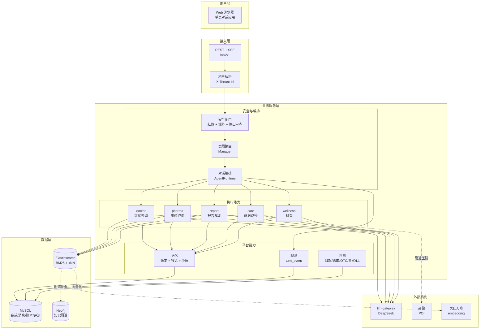

#### 9.1.2 数据模型图

工具型产品简化数据模型，聚焦会话、记忆、评测三条主线。

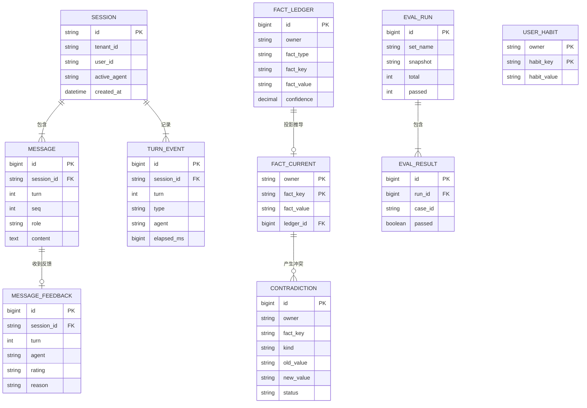

**实体说明：**

| 实体 | 说明 | 关键约束 |
| --- | --- | --- |
| `session` | 会话 | 按 `(tenant_id, user_id, updated_at)` 索引；惰性创建，首条消息才落库 |
| `message` | 对话消息 | **只追加**：无 `updated_at`，不提供 UPDATE；`(session_id, seq)` 唯一键做幂等 |
| `turn_event` | 轮次事件 | 记录"怎么走到那句话"：路由、交接、模型调用、工具调用 |
| `fact_ledger` | 事实账本 | **只追加**：要纠错就再追加一条，当前值由投影推导 |
| `fact_current` | 账本投影 | 可重建；`(owner, fact_key)` 主键 |
| `contradiction` | 记忆矛盾 | `status` 取值 `open` / `resolved` / `dismissed` |
| `user_habit` | 用户习惯 | 偏好类，最新值有效，可覆盖——与档案分开存 |
| `message_feedback` | 回答反馈 | 同一轮同一 agent 重复提交时覆盖 |
| `eval_run` / `eval_result` | 评测跑批与结果 | 语料存文件，不建 `eval_case` 表 |

**为什么档案与习惯分表**：档案是事实（只追加、要审计、要矛盾检测），习惯是偏好（改了就覆盖）。两种写入语义放一张表，要么过敏史被静默覆盖，要么每次改口味都变成一条"矛盾"。

#### 9.1.3 核心业务流程图

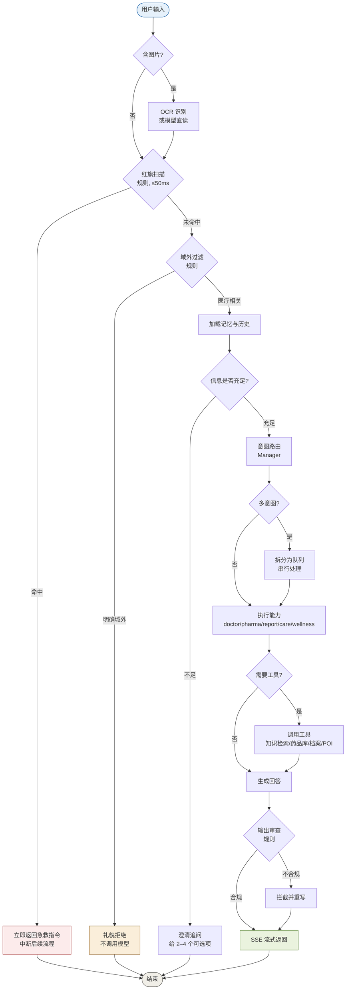

#### 9.1.4 状态机图

**会话生命周期：**

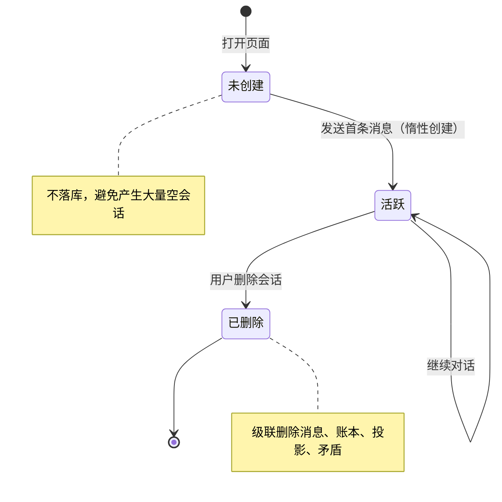

| 当前状态 | 触发事件 | 目标状态 | 操作角色 | 备注 |
| --- | --- | --- | --- | --- |
| 未创建 | 发送首条消息 | 活跃 | 用户 | 此时才写 `session` 表 |
| 活跃 | 发送消息 | 活跃 | 用户 | 轮次不设上限 |
| 活跃 | 删除会话 | 已删除 | 用户 | 级联清理 |

**记忆矛盾生命周期：**

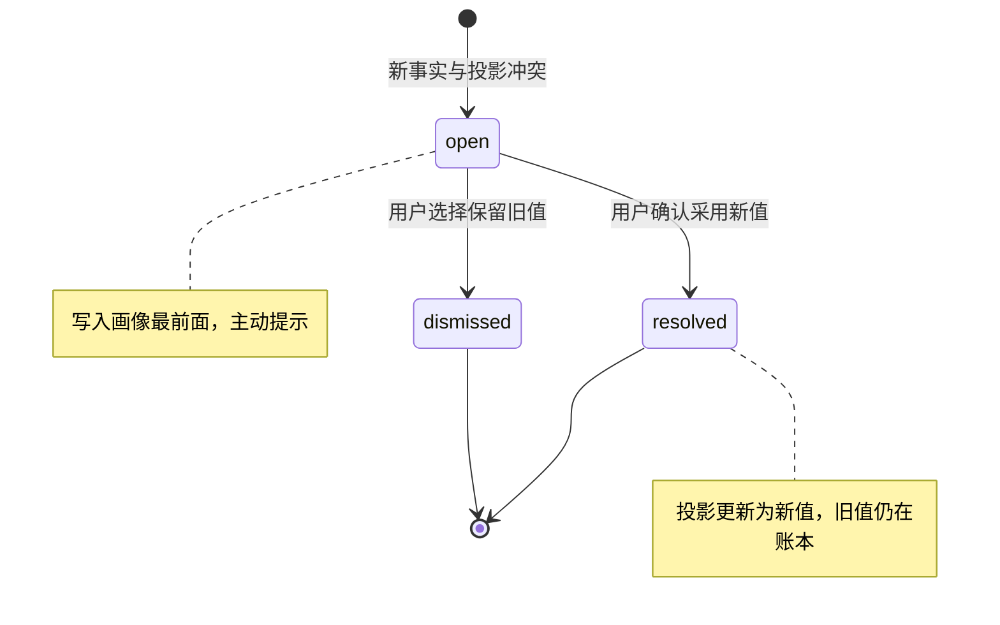

| 当前状态 | 触发事件 | 目标状态 | 操作角色 | 备注 |
| --- | --- | --- | --- | --- |
| open | 用户确认新值 | resolved | 用户 | 投影指向新账本条目 |
| open | 用户保留旧值 | dismissed | 用户 | 投影不变，记录用户选择 |
| open | — | open | — | 不自动解决，一直提示直到用户处理 |

#### 9.1.5 功能清单

本产品为单页应用，功能以"页面 + 组件"组织。

| 页面/组件 | 功能 | Web | 移动端 | 说明 |
| --- | --- | --- | --- | --- |
| `ChatView` | 对话主界面 | ✓ | ✓ | 响应式，移动端自适应 |
| `ChatView` | 消息流渲染 | ✓ | ✓ | 支持 Markdown、图片、指标表 |
| `ChatView` | 能力徽标 | ✓ | ✓ | 标注回答由哪个能力产生 |
| `ChatView` | 追问卡片 | ✓ | ✓ | 2–4 个可点选项 + 保留输入框 |
| `Composer` | 文本输入 | ✓ | ✓ | 多行，Enter 发送 / Shift+Enter 换行 |
| `Composer` | 图片粘贴 | ✓ | — | 全局 paste 监听；移动端用相册选择 |
| `Composer` | 图片选择 | ✓ | ✓ | 单图，≤5MB |
| `Composer` | 停止生成 | ✓ | ✓ | AbortController |
| `MessageItem` | 复制 | ✓ | ✓ | 非 HTTPS 降级为选中文本 |
| `MessageItem` | 点赞/点踩 | ✓ | ✓ | 点踩需选原因 |
| `MessageItem` | 分享图 | ✓ | ✓ | 本地 canvas 生成 |
| `MessageItem` | 长按菜单 | ✓ | ✓ | 含举报入口 |
| `SessionSidebar` | 历史会话列表 | ✓ | ✓ | 惰性创建后才有记录 |
| `SessionSidebar` | 新对话 | ✓ | ✓ | 不立即建会话 |
| `ProfileDrawer` | 健康档案查看 | ✓ | ✓ | 按类型分组，含证据与次数 |
| `ProfileDrawer` | 矛盾待确认 | ✓ | ✓ | 置顶显示 |
| `ProfileDrawer` | 一键清空 | ✓ | ✓ | 二次确认 |

---

### 9.2 产品需求详解

#### 9.2.1 分诊与路由

##### 9.2.1.1 业务流程图

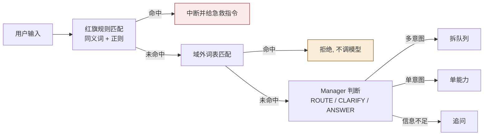

##### 9.2.1.2 页面交互

**对话主界面 · 首屏**

> 💡 设计原则：极简入口——用户不需要选择"我要问哪类问题"，只有输入框。

| 页面要素 | 说明 | 备注 |
| --- | --- | --- |
| 空态引导 | 3 条快捷问题 | 点击仅填入输入框，不直接发送 |
| 输入框 | 多行文本，支持粘贴图片 | 占位文案提示可问什么 |
| 发送按钮 | 有内容时可用 | 生成中变为"停止" |

**回答气泡**

| 元素 | 说明 | 触发条件 |
| --- | --- | --- |
| 能力徽标 | 显示"全科医生""药品助手"等 | 收到 `agent` 事件 |
| 交接提示 | "分诊转给全科医生" | 收到 `handoff` 事件 |
| 分段提示 | "继续处理下一部分" | 收到 `continue` 事件 |
| 红旗卡片 | 红色底，含急救指令 | 收到 `red_flag` 事件 |
| 免责声明 | 每条回答尾部 | 恒显示 |

**操作按钮**

| 按钮 | 操作说明 | 触发条件 | 权限 |
| --- | --- | --- | --- |
| 复制 | 整条文本进剪贴板 | 回答完成 | 所有人 |
| 点赞 | 立即生效 | 回答完成 | 所有人 |
| 点踩 | 弹 4 个原因，选后提交 | 回答完成 | 所有人 |
| 分享 | 生成 PNG 下载 | 回答完成 | 所有人 |
| 重试 | 重发上一条用户消息 | 出错时 | 所有人 |
| 停止 | 中断流式生成 | 生成中 | 所有人 |

##### 9.2.1.3 业务规则

| 编号 | 规则类型 | 规则描述 |
| --- | --- | --- |
| R1 | 约束 | 红旗判断必须在意图路由之前，不得调换顺序 |
| R2 | 约束 | 红旗与域外判断使用规则实现，不得调用 LLM |
| R3 | 触发条件 | 红旗命中时，跳过模型生成，直接返回急救指令 |
| R4 | 触发条件 | 域外命中时，不发起模型请求，返回拒绝话术 |
| R5 | 推论 | 同一件事的不同侧面不算多意图（"头疼吃什么药"是一件事） |
| R6 | 约束 | 多意图最多拆 3 个，超过则降级为"答主诉求 + 说明剩余" |
| R7 | 计算 | 红旗扫描耗时 ≤ 50ms（规则匹配，不含网络） |

##### AI 功能设计

> 💡 确定性-容错性四象限 + 六脉神剑交互模式

**任务特征分析：**

| 分析维度 | 评估 |
| --- | --- |
| 确定性 | 红旗判断：**高**（明确症状组合，规则可枚举） 意图路由：**中**（表达多样，但目标类别有限） |
| 容错性 | 红旗判断：**低**（漏报=医疗风险） 意图路由：**中**（判错可转走，但用户会感知延迟） |
| 推荐交互模式 | 红旗：**后台自动化**（用户无感，命中才显现） 路由：**CUI 嵌入 GUI**（对话为主，结果以徽标外化） |

**AI 交互设计：**

- **交互模式**：CUI（对话式界面）为主，能力徽标作为 GUI 辅助信息
- **人机边界**：AI 负责理解与生成；红旗判断、域外判断、输出审查由规则执行，AI 不参与
- **降级方案**：模型不可用时进入离线模式，给固定话术；路由失败时默认走 doctor 能力
- **监控指标**：路由准确率（Pass^3）、红旗召回率、降级率、多意图覆盖率

#### 9.2.2 症状咨询（doctor）

##### 9.2.2.1 业务流程图

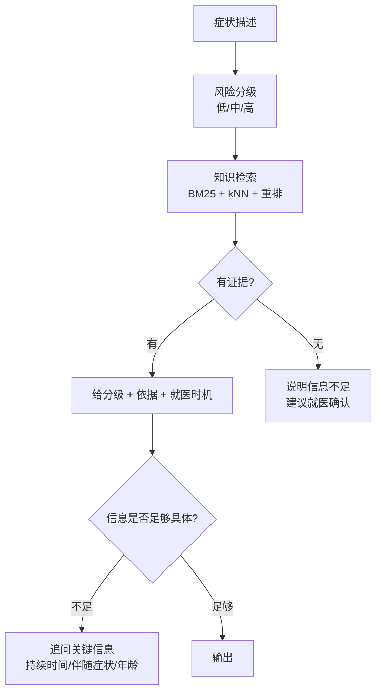

##### 9.2.2.2 页面交互

复用对话主界面，无独立页面。回答结构固定为四段：

| 段落 | 内容 | 是否必须 |
| --- | --- | --- |
| 风险判断 | 一句话说清严重程度 | 必须 |
| 依据 | 哪些症状支持这个判断 | 必须 |
| 现在该做什么 | 护理建议或立即就医 | 必须 |
| 什么情况必须就医 | 危险信号清单 | 必须 |

##### 9.2.2.3 业务规则

| 编号 | 规则类型 | 规则描述 |
| --- | --- | --- |
| R1 | 约束 | 不出现断言式病名（"你这是 XX 病"），只能用"可能""需要排除" |
| R2 | 约束 | 不给出具体药物剂量 |
| R3 | 触发条件 | 信息不足时先追问，不硬答 |
| R4 | 推论 | 风险分级为"高"时，必须包含"立即就医"或"拨打 120"的明确指令 |
| R5 | 约束 | 回答必须包含"什么情况必须就医"段落 |

#### 9.2.3 用药咨询（pharma）

##### 9.2.3.1 业务流程图

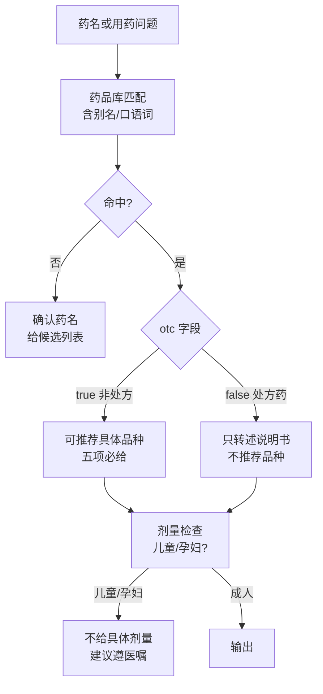

##### 9.2.3.2 页面交互

复用对话主界面。正向推荐时，回答必须包含五项：

| 必给项 | 示例 |
| --- | --- |
| 通用名 + 剂型 | "布洛芬缓释胶囊" |
| 成人用法 | "一次 1 粒，一日 2 次" |
| 疗程上限 | "连续使用不超过 3 天" |
| 停药指征 | "出现胃痛、黑便立即停药" |
| 关键禁忌 | "活动性消化道溃疡禁用" |

##### 9.2.3.3 业务规则

| 编号 | 规则类型 | 规则描述 |
| --- | --- | --- |
| R1 | 约束 | 处方属性以药品库 `otc` 字段为准，不以模型记忆判断 |
| R2 | 约束 | 处方药不推荐具体品种，只转述说明书 |
| R3 | 约束 | 儿童与孕妇不给具体剂量 |
| R4 | 触发条件 | 正向推荐时，五项必给内容缺一即视为不合规 |
| R5 | 推论 | 用户问"能不能一起吃"时，必须先查相互作用，不能凭常识回答 |

#### 9.2.4 报告解读（report）

##### 9.2.4.1 业务流程图

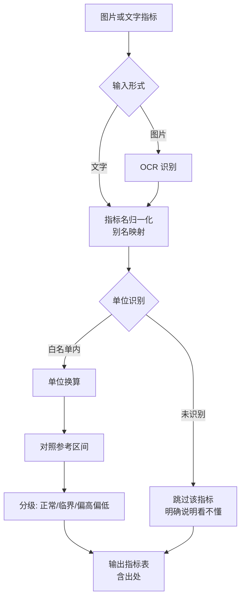

##### 9.2.4.2 页面交互

回答中包含指标表（非独立页面）：

| 列 | 内容 |
| --- | --- |
| 指标 | 归一化后的名称 |
| 结果 | 数值 + 单位 |
| 参考范围 | 区间 |
| 判定 | 正常 / 偏高 / 偏低 / 临界 |
| 出处 | 知识库条目 ID |

##### 9.2.4.3 业务规则

| 编号 | 规则类型 | 规则描述 |
| --- | --- | --- |
| R1 | 约束 | 单位换算只走白名单，不在白名单的单位不换算 |
| R2 | 约束 | 未识别单位时明确说"看不懂这个单位"，不猜 |
| R3 | 约束 | 分级阈值必须来自知识库，不由模型推断 |
| R4 | 计算 | 判定规则：`值 < 下限 → 偏低`；`值 > 上限 → 偏高`；`偏离 < 10% → 临界` |
| R5 | 推论 | 单项异常不直接给病名，需结合其他指标与症状 |

#### 9.2.5 就医路径（care）

##### 9.2.5.1 业务流程图

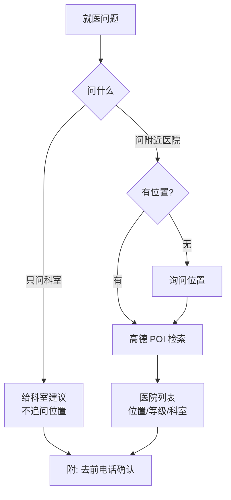

##### 9.2.5.2 页面交互

复用对话主界面。医院列表以表格呈现：

| 列 | 内容 |
| --- | --- |
| 医院名称 | — |
| 等级 | 三甲 / 三乙 / 二甲等 |
| 距离 | 直线距离 |
| 相关科室 | 是否有所需科室 |

##### 9.2.5.3 业务规则

| 编号 | 规则类型 | 规则描述 |
| --- | --- | --- |
| R1 | 约束 | 只问科室时不追问位置——用户没要附近医院，多问一句就是让他白等一轮 |
| R2 | 约束 | 医院信息只含位置、科室、等级，不给号源与排队时长 |
| R3 | 约束 | 不导流到特定医院，不收推广费 |
| R4 | 触发条件 | 输出医院列表时必须附"去前电话确认"提示 |

#### 9.2.6 记忆与档案

##### 9.2.6.1 业务流程图

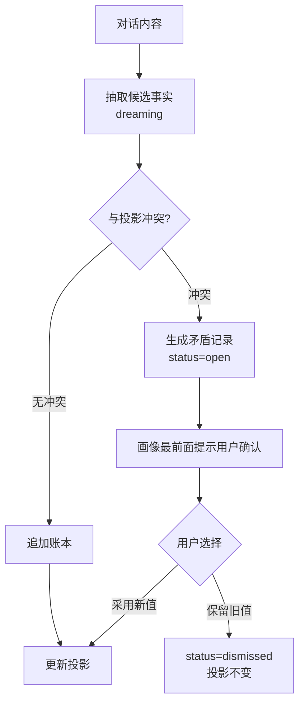

##### 9.2.6.2 页面交互

**健康档案抽屉（`ProfileDrawer`）**

| 区域 | 内容 | 交互 |
| --- | --- | --- |
| 待确认矛盾 | 置顶，最多 3 条 | 点"采用新的"/"保留原值" |
| 档案分组 | 按类型分组：过敏、慢病、用药、手术、家族史 | 折叠展开 |
| 每条事实 | 值 + 记录次数 + 最近证据 | 点开看证据原文 |
| 底部操作 | 一键清空 | 二次确认弹窗 |

##### 9.2.6.3 业务规则

| 编号 | 规则类型 | 规则描述 |
| --- | --- | --- |
| R1 | 约束 | 事实账本只追加，不提供修改接口 |
| R2 | 约束 | 当前值必须由投影推导，不可直接写 |
| R3 | 约束 | 矛盾不自动解决，必须用户确认 |
| R4 | 触发条件 | 检测到矛盾时，在画像最前面提示 |
| R5 | 约束 | 用户清空档案时，级联删除账本、投影、矛盾、习惯 |
| R6 | 推论 | 过敏史与用药禁忌冲突时，风险等级提升为"高" |

#### 9.2.7 安全闸门

##### 9.2.7.1 业务流程图

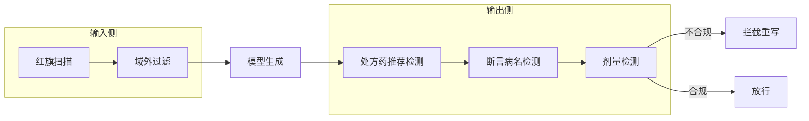

##### 9.2.7.2 页面交互

安全事件对用户可见的形式：

| 事件 | 用户看到 | 是否可关闭 |
| --- | --- | --- |
| 红旗命中 | 红色卡片 + 急救指令，后续对话仍可继续 | 否 |
| 域外拒绝 | 礼貌说明"这个问题我帮不上" | 否 |
| 输出拦截 | 重写后的合规回答，用户无感 | — |

##### 9.2.7.3 业务规则

| 编号 | 规则类型 | 规则描述 |
| --- | --- | --- |
| R1 | 约束 | 安全判断不使用 LLM，全部走规则 |
| R2 | 约束 | 红旗识别必须先于路由，输出审查必须在生成之后 |
| R3 | 触发条件 | 输出中出现处方药推荐、断言病名、儿童剂量时，拦截并重写 |
| R4 | 计算 | 红旗召回率 = 命中数 / 应命中数，目标 100% |
| R5 | 推论 | 红旗命中不阻断后续对话，但每次命中都记入事件表 |

#### 9.2.8 会话与交互

##### 9.2.8.1 业务流程图

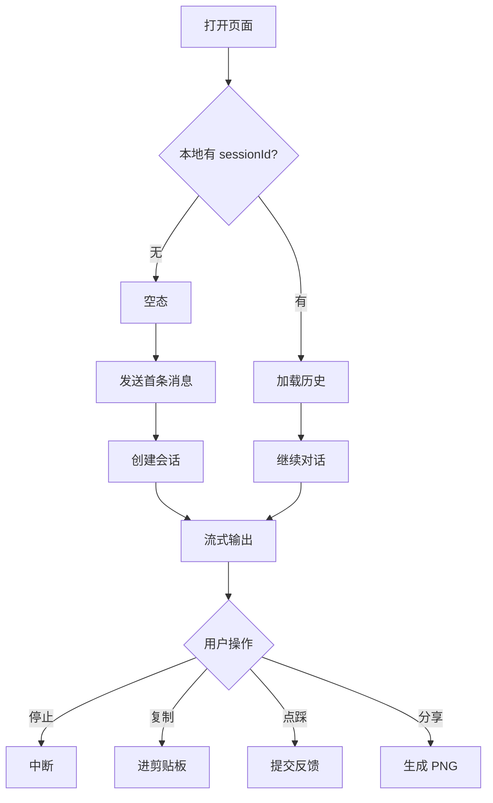

##### 9.2.8.2 页面交互

**侧栏（`SessionSidebar`）**

| 元素 | 说明 |
| --- | --- |
| 新对话 | 只清空当前视图，不立即建会话 |
| 会话列表 | 标题取首条消息前 20 字；显示轮次与时间 |
| 删除 | 长按或悬浮出现，二次确认 |

**输入区（`Composer`）**

| 元素 | 说明 |
| --- | --- |
| 输入框 | 自动增高，最多 6 行 |
| 图片预览 | 粘贴/选择后显示缩略图，可移除 |
| 发送/停止 | 同一位置切换 |

##### 9.2.8.3 业务规则

| 编号 | 规则类型 | 规则描述 |
| --- | --- | --- |
| R1 | 约束 | 会话惰性创建：首条消息才落库，避免产生大量空会话 |
| R2 | 约束 | `(session_id, seq)` 唯一，重试不产生重复消息 |
| R3 | 触发条件 | 点踩时必须选原因才能提交 |
| R4 | 约束 | 分享图本地生成，不上传服务端 |
| R5 | 约束 | 复制在非 HTTPS 环境降级为选中文本 |
| R6 | 计算 | 会话标题 = 首条用户消息前 20 字，超出截断加省略号 |

#### 9.2.9 多租户

##### 9.2.9.1 业务流程图

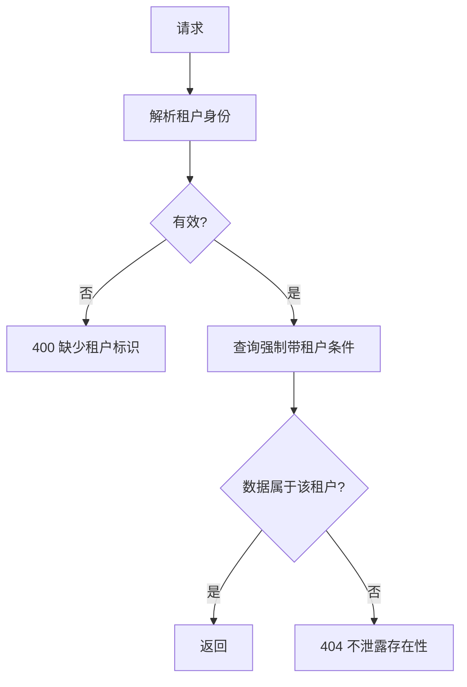

##### 9.2.9.2 页面交互

当前无租户管理界面。租户身份通过请求头传递，前端不感知。

##### 9.2.9.3 业务规则

| 编号 | 规则类型 | 规则描述 |
| --- | --- | --- |
| R1 | 约束 | 所有查询必须带租户条件，在数据层兜底 |
| R2 | 约束 | 跨租户访问返回 404，不返回 403——不泄露"存在但无权" |
| R3 | 约束 | 租户身份不得由客户端声明，必须从凭证解析 |
| R4 | 约束 | 配置隔离用版本指针，不为每个租户复制一套 prompt |
| R5 | 触发条件 | 删除租户时级联清理其全部数据 |

> ⚠️ **当前缺陷**：`X-Tenant-Id` 直接来自请求头且无校验，任何人构造一个值就能读写他人数据。这是越权漏洞，已在验收单记为 P0 待修。

#### 9.2.10 评测与观测

##### 9.2.10.1 业务流程图

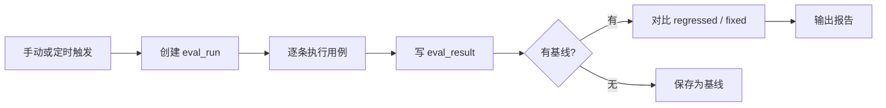

##### 9.2.10.2 页面交互

评测通过接口触发，无前端界面：

| 接口 | 用途 | 耗时 |
| --- | --- | --- |
| `POST /evaluation/redflag` | 红旗 50 条 | 秒级 |
| `POST /evaluation/route?trials=3` | 路由 Pass^3 | 约 5 分钟 |
| `POST /evaluation/otc` | OTC 合规 8 条 | 约 40 秒 |
| `POST /evaluation/factcheck` | 事实校验 8 条 | 约 20 秒 |
| `POST /evaluation/l1?domain=all` | L1 四域 42 条 | 约 10 分钟 |

##### 9.2.10.3 业务规则

| 编号 | 规则类型 | 规则描述 |
| --- | --- | --- |
| R1 | 约束 | 判分器变更需回放历史样本，防止"改判分器刷分" |
| R2 | 约束 | 每次跑批记录 `config_version + model + prompt_hash`，保证可复现 |
| R3 | 计算 | 路由准确率采用 Pass^k（k=3），非 Pass@k |
| R4 | 触发条件 | 与基线 diff 出现 `regressed` 时，阻断发布 |
| R5 | 约束 | 不做 LLM 互评——测的是两个模型的一致性，不是正确性 |

---

### 9.3 异常情况处理方案

| 异常类型 | 异常场景 | 处理方案 |
| --- | --- | --- |
| 网络异常 | 流式生成中断 | 前端显示"连接中断"+ 重试按钮；已收到的内容保留可读 |
| 网络异常 | 提交反馈失败 | 按钮状态回滚，提示"反馈没提交上" |
| 模型异常 | 模型返回 402 余额不足 | 进入离线模式，返回固定话术，日志记录 |
| 模型异常 | 模型超时（60s） | 明确告知超时，不返回半截内容 |
| 数据异常 | OCR 识别失败 | 说明"图片看不清"，建议文字描述或换图 |
| 数据异常 | 单位无法识别 | 跳过该指标并明确说明，不猜 |
| 并发冲突 | 同一会话两个窗口同时发消息 | `(session_id, seq)` 唯一键冲突，后者提示刷新 |
| 误操作 | 误删会话 | 二次确认弹窗；删除为软删除，7 天内可恢复 [TODO: 软删除未实现] |
| 误操作 | 误清空档案 | 二次确认 + 输入"确认清空"文字 |
| 业务异常 | 多意图处理到一半步数耗尽 | 说明"处理了一部分，剩下请单独发"，不静默丢弃 |
| 业务异常 | 澄清后用户没回答 | 保留 pending，下轮继续处理 [TODO: 当前靠 agent 自行识别，未做显式状态] |
| 依赖异常 | 知识服务不可用 | 降级为纯模型回答，`/health` 标记 `degraded` |
| 依赖异常 | 中间件缺失 | 知识服务降级内存；主服务连不上 MySQL 直接启动失败（不降级） |

---

## 10、数据埋点

> 💡 方法论提示：C 端工具型产品重点在功能采纳率、使用深度与异常率；医疗类产品额外关注安全事件与反馈质量。

### 10.1 埋点策略

- **埋点目标**：回答三个问题——用户在用哪些能力、回答质量是否可接受、安全闸门是否有效
- **当前现状**：仅后端有事件记录（`turn_event` 表），**前端无埋点**
- **埋点工具**：[TODO: 需选型。候选：自建（现有 MySQL + 事件表）/ 神策 / GrowingIO]

### 10.2 页面埋点

| 页面名称 | 事件名称 | 事件类型 | 采集参数 | 用途说明 | 现状 |
| --- | --- | --- | --- | --- | --- |
| 对话主界面 | `page_view` | 页面曝光 | `has_session`, `is_mobile` | 监控日活与入口来源 | 未实现 |
| 对话主界面 | `session_restore` | 恢复会话 | `session_id`, `msg_count` | 评估刷新恢复成功率 | 未实现 |
| 健康档案抽屉 | `profile_open` | 抽屉打开 | `entry`（主动/矛盾提示） | 评估档案能力使用率 | 未实现 |
| 历史会话侧栏 | `sidebar_open` | 侧栏展开 | `session_count` | 评估会话管理使用率 | 未实现 |

### 10.3 行为埋点

| 操作名称 | 事件名称 | 触发条件 | 采集参数 | 用途说明 | 现状 |
| --- | --- | --- | --- | --- | --- |
| 发送消息 | `msg_send` | 点击发送 | `has_image`, `text_len`, `is_first` | 基础使用量 | 后端 `message` 表可推算 |
| 能力路由 | `route_decided` | 路由完成 | `agent`, `intent_count`, `elapsed_ms` | 各能力使用占比 | 已有（`turn_event.type=route`） |
| 能力交接 | `agent_handoff` | 发生转交 | `from_agent`, `to_agent` | 交接频率与路径 | 已有（`turn_event.type=handoff`） |
| 红旗命中 | `red_flag_hit` | 规则命中 | `rule_id`, `matched_text` | 安全事件追踪 | 已有（`turn_event.type=red_flag`） |
| 澄清追问 | `clarify_asked` | 信息不足 | `question`, `option_count` | 追问有效性 | 已有（`turn_event.type=clarify`） |
| 复制回答 | `msg_copy` | 点击复制 | `msg_id`, `agent` | 内容价值信号 | 未实现 |
| 点踩 | `feedback_down` | 提交点踩 | `agent`, `reason` | 质量问题定位 | 已有（`message_feedback` 表） |
| 分享 | `msg_share` | 生成分享图 | `msg_id`, `agent` | 传播意愿 | 未实现 |
| 追问卡片点击 | `clarify_click` | 点击卡片选项 | `option_index`, `question` | 卡片有效性 | 未实现 |
| 停止生成 | `gen_stop` | 点击停止 | `elapsed_ms`, `token_count` | 回答过长/过慢信号 | 未实现 |
| 重试 | `msg_retry` | 点击重试 | `error_type` | 失败率 | 未实现 |

### 10.4 业务指标埋点

| 指标名称 | 计算方式 | 数据来源 | 统计周期 | 现状 |
| --- | --- | --- | --- | --- |
| 日活用户 | `count(distinct user_id)` | `session` 表 | 日 | 可算 |
| 人均对话轮次 | `count(message where role=user) / count(distinct session_id)` | `message` 表 | 日 | 可算 |
| 首次回答采纳率 | 未追问即结束的会话 / 总会话 | 需前端埋点 | 日 | 不可算 |
| 点踩率 | 点踩数 / 回答数 | `message_feedback` | 日 | 可算 |
| 点踩原因分布 | `group by reason` | `message_feedback` | 周 | 可算 |
| 红旗命中率 | 红旗命中轮次 / 总轮次 | `turn_event` | 日 | 可算 |
| 降级率 | 兜底话术次数 / 总回答数 | 需新增事件 | 日 | 不可算 |
| 首段延迟 P95 | 首 token 时间分位值 | `turn_event.elapsed_ms` | 日 | 部分可算 |
| 路由准确率 | 评测结果 | `eval_run` / `eval_result` | 每次发布 | 可算 |
| 多意图覆盖率 | 完整处理的多意图 / 多意图总数 | `turn_event` | 周 | 可算 |

**缺口**：`降级率` 与 `首次回答采纳率` 当前无法计算，前者缺事件，后者缺前端埋点。这两项恰好对应门禁 5 与核心成功标准，需优先补。

---

## 11、角色和权限

> 💡 方法论提示：工具型产品采用简化角色设计，重点在功能权限；因涉及 B 端租户，补充多租户隔离说明。

### 11.1 角色定义

| 角色名称 | 角色说明 | 权限范围 | 数据范围 | 现状 |
| --- | --- | --- | --- | --- |
| 个人用户 | 日常使用健康咨询功能 | 除管理功能外的全部 | 仅本人数据 | 已实现 |
| 租户管理员 | 机构侧管理本租户用户与配置 | 本租户内全部 | 本租户数据 | [TODO: 未实现] |
| 平台管理员 | 跨租户运营与审计 | 全部 | 全部租户 | [TODO: 未实现] |
| 系统（Agent） | 执行对话编排与工具调用 | 仅业务接口 | 当前租户当前用户 | 已实现 |

### 11.2 功能权限差异

| 功能 | 个人用户 | 租户管理员 | 平台管理员 |
| --- | --- | --- | --- |
| 发起对话 | ✓ | ✓ | ✓ |
| 查看本人档案 | ✓ | ✓ | ✓ |
| 清空本人档案 | ✓ | ✓ | ✓ |
| 查看本租户其他用户会话 | — | [TODO] | ✓ |
| 配置本租户规则/prompt 版本 | — | [TODO] | ✓ |
| 查看评测报告 | — | [TODO] | ✓ |
| 跨租户数据访问 | — | — | [TODO] |

### 11.3 数据权限与租户隔离

**隔离级别**：当前为 **Row 级**——所有业务表带 `tenant_id` 或 `owner`（`tenant:user`）字段，查询强制带条件。

| 层级 | 实现方式 | 说明 |
| --- | --- | --- |
| 应用层 | `TenantResolver` 解析 | 第二道防线，不是唯一一道 |
| 数据层 | 所有 SQL 带 `tenant_id` 条件 | 第一道防线，漏一处即事故 |
| 配置层 | `config_version` 版本指针 | 不复制副本，避免配置漂移 |

**数据范围规则：**

| 角色 | 规则 | 说明 |
| --- | --- | --- |
| 个人用户 | `owner = tenant:user` | 只能看到自己的会话与档案 |
| 租户管理员 | `tenant_id = 本租户` | [TODO: 未实现] |
| 平台管理员 | 无限制 | [TODO: 未实现] |

### 11.4 当前安全缺陷

| 缺陷 | 风险 | 状态 |
| --- | --- | --- |
| `X-Tenant-Id` 来自请求头且无校验 | 任何人构造请求头即可读写他人数据 | **P0 待修** |
| 无租户管理员/平台管理员界面 | 无法做机构侧运营 | 未实现 |
| 无审计日志 | 内部查看会话无法追溯 | 未实现 |

---

## 12、待决事项

| 编号 | 待决事项 | 涉及章节 | 负责人 | 预计决策时间 | 当前状态 |
| --- | --- | --- | --- | --- | --- |
| TBD-1 | 合规评估：是否被认定为互联网诊疗，需何种资质 | 6.3 R4 | [TODO: 法务] | 上线前 | 待评估 |
| TBD-2 | 租户身份认证方案：JWT / OAuth / 内部签名 | 11.3 | [TODO] | v1.5 | 待设计 |
| TBD-3 | 埋点工具选型：自建 / 神策 / GrowingIO | 10.1 | [TODO] | v1.5 | 待讨论 |
| TBD-4 | 降级率埋点方案（当前无数据，门禁 5 无法判定） | 10.3、10.4 | [TODO] | v1.5 | 待设计 |
| TBD-5 | 首段延迟优化方案：流式预热 / 连接复用 / 首段截断 | 3.1、6.3 R6 | [TODO] | v1.5 | 待验证 |
| TBD-6 | 评测语料授权：是否需逐条取得来源方许可 | 6.3 R8 | [TODO] | 商用前 | 待确认 |
| TBD-7 | 是否引入医生审核机制以提升信任 | 6.3 R7 | [TODO] | 商业化前 | 待讨论 |

> ⚠️ 待决事项 7 项，其中 TBD-1（合规评估）是阻塞级，建议优先解决。

---

## 附：待完善清单

### 自检结果

**重大风险项快扫：**

| 风险项 | 检查内容 | 状态 |
| --- | --- | --- |
| R1 产品定位 | 能否一句话回答"为谁、解决什么问题、提供什么价值" | ✅ 已覆盖（1.1） |
| R2 核心业务流程 | 能否从 PRD 重建端到端流程 | ✅ 已覆盖（9.1.3） |
| R3 ER 模型缺陷 | 业务型/交易型才要求完整 ER | 不适用（工具型，已简化） |
| R4 角色权限 | 多角色系统是否有权限设计 | ⚠️ 需完善（租户管理员/平台管理员未实现） |
| R5 功能致命缺口 | 核心流程是否有断裂环节 | ⚠️ 需完善（FR-05 用药咨询未验证） |
| R6 需求与业务脱节 | 功能设计是否匹配实际场景 | ✅ 已覆盖（第 2 章四场景） |
| R7 合规风险 | 强监管行业是否考虑合规 | ⚠️ 需完善（无资质评估、无审计日志） |
| R8 SaaS 多租户 | 商业化 SaaS 是否有租户隔离 | ⚠️ 需完善（有隔离但身份可伪造） |

**12 维度扫描：**

| 维度 | 对应章节 | 完成度 | 需补充内容 |
| --- | --- | --- | --- |
| 01 业务分析质量 | 第 1 章 | 高 | 无 |
| 02 产品类型适配性 | 阶段 0 | 高 | 无 |
| 03 产品定位合理性 | 第 3 章 | 高 | 定位与目标清晰 |
| 04 场景分析与用户旅程 | 第 2 章 | 高 | 四场景完整 |
| 05 文档结构完整性 | 全文 | 高 | 12 章齐全 |
| 06 架构设计质量 | 9.1.1 | 高 | 五层架构完整 |
| 07 数据建模质量 | 9.1.2 | 中 | 工具型已简化，够用 |
| 08 流程与角色设计 | 9 + 11 | 中 | 角色管理未实现 |
| 09 交互设计质量 | 9.2 | 高 | 页面要素完整 |
| 10 MVP 策略与演进 | 4.3 | 高 | 含验证假设 |
| 11 异常处理与健壮性 | 9.3 | 高 | 13 类异常 |
| 12 AI 功能设计质量 | 9.2.1 | 中 | 仅分诊模块展开，其余可补 |

### 🔴 必须补充（影响 PRD 可评审性）

1. **合规评估结论**（6.3 R4、TBD-1）：医疗类产品的合规是上线前提。需法务出具"是否构成互联网诊疗"的意见，否则功能设计再完整也不能发。

### 🟡 建议补充（提升 PRD 质量）

1. **租户管理员与平台管理员的功能设计**（11.2）：当前只有个人用户角色有实现，B 端能力是空白。
2. **降级率埋点方案**（10.3）：门禁 5 因缺数据无法判定，需先补埋点。
3. **AI 功能设计扩展到其他模块**（9.2.2–9.2.5）：当前只有分诊模块做了四象限分析。

### 🟢 可选完善（锦上添花）

1. **移动端适配细节**（9.1.5）：当前标注"响应式"，但移动端交互差异未展开。
2. **多咨询人档案**（4.3 延后项）：家庭场景真实存在，可在 v1.5 规划中细化。

---

> 💡 建议：先补充 🔴 类一项（合规评估），PRD 才具备对外评审条件。当前版本适合作为**内部对齐文档**——它准确描述了"做了什么、没做什么、卡在哪"。

---

## 附录：PRD 与项目文档的映射

| PRD 章节 | 项目文档来源 |
| --- | --- |
| 1 项目背景 | 需求规格 §1、竞品对照 §5 |
| 2 需求基本情况 | 需求规格 §1.2、§2 用户旅程 |
| 3 收益目标 | 需求规格 §4 非功能、门禁报告 |
| 4 方案概述 | 需求规格 §6 范围分期、概要设计 |
| 5 项目范围 | 需求规格 §1.3 能力边界、技术方案 |
| 6 项目风险 | 门禁报告、验收单、开源发布记录 |
| 7 术语 | 全文提取 |
| 8 参考文献 | 项目 docs 目录 |
| 9 功能需求 | 需求规格 FR-01~13、交互增量 FR-14~20、图片粘贴 FR-21、域规格 00–11 |
| 10 数据埋点 | `turn_event` 表设计、测试策略 |
| 11 角色权限 | 需求规格 FR-13 多租户 |
| 12 待决事项 | 各章节 TODO 汇总 |
