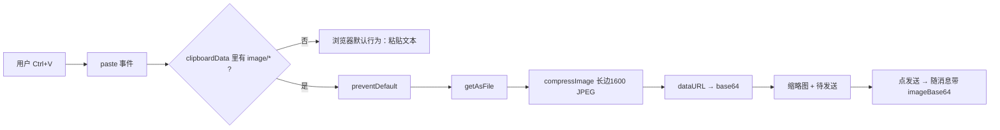

# 技术方案 · 图片粘贴（FR-21）

日期：2026-11-26　｜　对应需求：`06-增量需求-图片粘贴.md`

---

## 1. 方案选择

| 方案 | 可行性 | 结论 |
|---|---|---|
| `navigator.clipboard.read()` | 需要用户授权 + HTTPS；HTTP 局域网调试直接不可用 | ❌ |
| 输入框 `paste` 事件 | 只有聚焦时才触发，用户没点输入框就按 Ctrl+V 会漏 | ⚠️ |
| **window `paste` 事件** | 不挑焦点，HTTP/HTTPS 都能用，零权限 | ✅ 采用 |

**为什么不用 `clipboard.read()`**：它是"主动读剪贴板"，浏览器会弹权限框；
而 `paste` 事件是用户主动触发，没有权限问题，也不需要 HTTPS。

---

## 2. 数据流



---

## 3. 详细设计

### 3.1 新增 `utils/clipboardImage.ts`

纯函数，不碰 DOM，便于单测：

```ts
export interface ClipboardLike {
  items?: ArrayLike<{ type: string; getAsFile(): File | null }>
  files?: ArrayLike<File>
}

/** 取第一张图片；没有返回 null。 */
export function firstImage(data: ClipboardLike | null): File | null

/** 图片数量，用于"一次只能发一张"的提示。 */
export function imageCount(data: ClipboardLike | null): number
```

实现要点：

1. 先扫 `items`（Chrome/Edge/Firefox 都有），`type.startsWith('image/')` 才取
2. `getAsFile()` 可能返回 null（某些虚拟文件），跳过
3. `items` 为空时退回 `files`（Safari 粘贴文件时只有 `files`）
4. **只认 `image/*`**：PDF、Word 一律不处理，交给浏览器默认行为

### 3.2 Composer 挂监听

```ts
onMounted(() => window.addEventListener('paste', onPaste))
onBeforeUnmount(() => window.removeEventListener('paste', onPaste))

function onPaste(e: ClipboardEvent) {
  const file = firstImage(e.clipboardData)
  if (!file) return                 // 纯文本：不拦截
  e.preventDefault()                // 有图就不让富文本/HTML 落进输入框
  attach(file)
  if (imageCount(e.clipboardData) > 1) show('一次只能发一张，已取第一张')
}
```

`attach(file)` 与原来的"选择文件"共用：

```ts
async function attach(file: File) {
  if (!file.type.startsWith('image/')) return
  const dataUrl = await compressImage(file)
  preview.value = dataUrl
  imageB64.value = dataUrl.split(',')[1] ?? ''
  await nextTick()
  textareaRef.value?.focus()        // 粘贴后能直接补一句"这是今天的化验单"
}
```

**挂 window 而不是 textarea 的理由**：用户截完图不一定先点输入框。
挂在 window 上，"随手 Ctrl+V"就能用；代价是要判断剪贴板内容，
不是图片就完全不拦截，所以不影响任何输入框的正常粘贴。

### 3.3 组件结构变化

```
Composer.vue
├── 新增 onPaste / attach / textareaRef
├── 复用 compressImage（utils/image.ts）
└── 无新增子组件
```

不新增 composable：这段逻辑只服务输入区，抽出去反而多一层。

---

## 4. 影响范围

| 层 | 影响 | 说明 |
|---|---|---|
| 后端 | **无** | 复用现有 `imageBase64` 字段 |
| 接口 | **无** | 不发新请求 |
| 数据库 | **无** | 图片本来就不落库 |
| 前端文件 | `Composer.vue`、新增 `utils/clipboardImage.ts`、`style.css`、`ChatView.vue`（提示文案） | 4 个文件 |
| 行为变化 | 全局 `Ctrl+V` 在"剪贴板有图片"时被接管 | 纯文本粘贴完全不受影响 |
| 权限 | 无新增 | `paste` 事件不需要授权 |
| 兼容性 | Chrome / Edge / Firefox / Safari 均支持 `paste` + `clipboardData` | Safari 走 `files` 兜底 |

**不影响的地方**（明确列出，避免回归误判）：

- 点「选择文件」上传：走同一个 `attach`，行为不变
- 位置输入框：粘贴纯文本照常
- 报告 Tab 已移除，不再涉及

---

## 5. 边界与错误

| 场景 | 处理 |
|---|---|
| `clipboardData` 为 null | 直接返回，不报错 |
| `getAsFile()` 返回 null | 跳过该项，继续找下一项 |
| 图片解码失败（损坏文件） | 提示"图片读取失败，换一张试试"，不覆盖已有缩略图 |
| 多张图 | 取第一张 + 提示 |
| 正在生成回答时粘贴 | 允许添加，发送按钮仍禁用；生成结束后可发 |
| 已有待发送图片时再粘贴 | 覆盖旧图（与"重新选择文件"一致），不弹二次确认 |
| 超大图（>10MB） | 压缩后通常 <500KB；压缩失败走错误提示 |

---

## 6. 质量保障

### 6.1 逻辑单测（不引测试框架）

`firstImage` / `imageCount` 是纯函数，用 `tsc` 编译到临时目录后由 Node 断言：

| 用例 | 期望 |
|---|---|
| 单个 image/png | 返回该文件 |
| image + text 混合 | 返回图片，忽略文本 |
| 只有 text/plain | null |
| 两个 image | 返回第一个，count=2 |
| `items` 为空、`files` 有图 | 从 files 取到 |
| `items` 项 `getAsFile()` 返回 null | 跳过，不抛异常 |
| data 为 null | null / 0 |

### 6.2 构建验证

- `vue-tsc --noEmit`：类型
- `vite build`：打包

### 6.3 手工验证（由人执行）

按需求文档 A-01 ~ A-10 逐条走。重点三条：

1. 微信/QQ 截图 → Ctrl+V → 缩略图出现
2. 在位置输入框按 Ctrl+V（剪贴板是图片）→ 图片仍进待发送区
3. 复制一段文字 → Ctrl+V → 正常插入文字，不弹图片提示

---

## 7. 回滚

删除 `Composer.vue` 里的两个生命周期钩子 + `onPaste` 即可，其余代码不受影响。
`utils/clipboardImage.ts` 可保留（无引用即不打包）。
