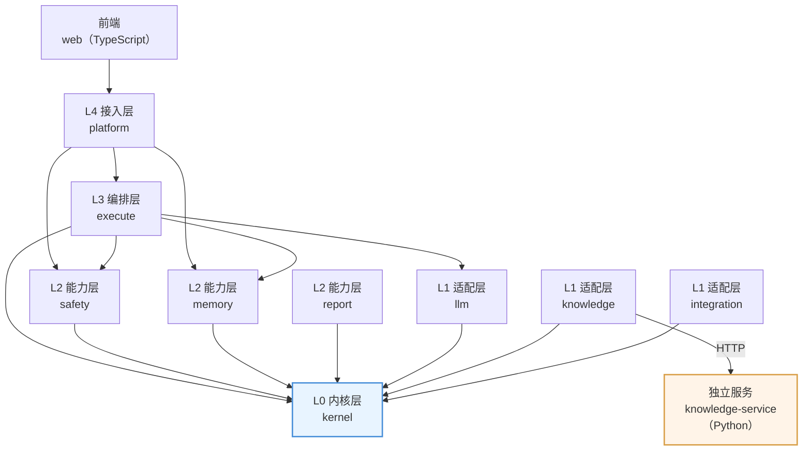

# 详细实现设计 · 总览与编码约定

版本：v1.0　｜　日期：2026-11-26
上游：`../域规格/`（域规格）、`../技术方案.md`
定位：**照着写就能出代码，不用再猜**

---

## 1. 这份文档和域规格的分工

| 文档 | 回答 | 读者 |
|---|---|---|
| 域规格 | 这个域做什么、规则是什么、怎么验收 | 开发 + 测试 |
| **详细设计** | **有哪些类、方法签名长什么样、边界怎么处理** | 开发 |

域规格说"处方药不推荐品种"，详细设计说"`DrugInfoTool` 返回 `otc=false` 时，`pharma` 的 prompt 注入哪句话，`SafetyGate` 用哪条正则兜底"。

---

## 2. 模块依赖图

依赖只能从高到低。违反就是架构错误，用 ArchUnit 卡住。



**kernel 在最低层**，它不认识任何业务概念。`AgentKernel` 只知道"跑一个 agent、调工具、产出 Decision"，不知道 doctor 和 pharma 的区别。

**能力层之间不互相依赖**。`safety` 不 import `memory`，`memory` 不 import `safety`。需要协作时由 `execute` 编排。

**`knowledge-service` 是进程外的独立服务**，不在 Java 分层里。它只被 `L1B knowledge` 通过 HTTP 调用，反向不成立（它不认识 Java 的任何概念）。

---

## 3. 分册清单

**这套文档覆盖整个项目，不只是 Java 进程。** 分两组：在线链路按依赖顺序写（前面的先实现，后面的才有依赖可依），独立服务按被调用顺序排在后面。

### 3.1 在线链路（Java）

| 册 | 模块 | 关键类 | 依赖 |
|---|---|---|---|
| 01 | kernel | AgentKernel / Decision / Session | 无 |
| 02 | llm | OpenAiCompatibleClient / DecisionParser | kernel |
| 03 | safety | RedFlagScanner / SafetyGate | 无 |
| 04 | memory | FactLedger / ContradictionDetector | kernel/domain |
| 05 | knowledge | KnowledgeClient / 三个 Tool | kernel/infra |
| 06 | report | ReportAnalyzer | 无 |
| 07 | integration | AmapClient / 三个 Tool | kernel/infra |
| 08 | execute | AgentRuntime / ExecuteAgents | 全部下层 |
| 09 | platform | ChatController / SessionStore | execute |
| 10 | evaluation | EvaluationRunner | knowledge |

### 3.2 独立服务与前端

| 册 | 单元 | 关键类 | 语言 | 被谁调用 |
|---|---|---|---|---|
| 11 | knowledge-service | KnowledgeStore / EsStore / Reranker | Python | 05 knowledge（HTTP） |
| 12 | web | App / ChatView / useChat | TypeScript | 人（浏览器），调 09 platform |

**11 排在最后不是因为它是最后一层**，而是因为它不在 Java 的依赖图里。它被 05 调用，所以 05 的实现细节必须能对上 11 的契约——两册的 `Hit` 字段、超时值、降级语义是同一份约定的两面。

**12 是唯一一册写前端的**。它不参与 Java 分层，只消费 `09 platform` 的接口；对应需求见 `04-增量需求-交互能力.md`，技术方案见 `05-技术方案-交互能力.md`。

---

## 4. 编码约定

### 4.1 空值

| 场景 | 做法 | 禁止 |
|---|---|---|
| 查不到 | `Optional.empty()` | 返回 null |
| 空集合 | `List.of()` | 返回 null |
| 可选字段 | `Optional<T>` | 用 `""` 表示没有 |

**理由**：null 在链路里传三层就没人记得判空了，而空字符串会让"没有"和"空值"混在一起。

### 4.2 异常

| 类型 | 用什么 | 例子 |
|---|---|---|
| 参数错误 | `IllegalArgumentException` | ID 格式不对 |
| 状态错误 | `IllegalStateException` | 配置未加载 |
| 外部失败 | **不抛**，返回降级值 | 检索超时返回空列表 |
| 业务拒绝 | `Decision.Clarify` | 信息不足 |

**外部失败不抛异常**。抛了就要在每层 catch，最后变成一堆 `try-catch` 包着空实现。降级值 + 日志更清楚。

### 4.3 日志

每条必须有：`trace_id` `session_id` `tenant_id` `agent` `latency_ms`。

**不记用户原文**，只记 ID 与摘要。原文在 `message` 表里，按 ID 查。

### 4.4 幂等

| 接口 | 幂等键 |
|---|---|
| 创建会话 | 客户端生成，24h 有效 |
| 发消息 | `session_id + turn` |
| 写事实 | `owner + fact_key + evidence_hash` |

### 4.5 并发

| 对象 | 线程安全 | 说明 |
|---|---|---|
| `Session` | ❌ | 单轮内单线程编排，不并发写 |
| `ToolRegistry` | ✅ | 启动时注册，之后只读 |
| `FactLedger` | ✅ | 数据库唯一约束兜底 |

**Session 不做线程安全**。做了会引入锁，而实际并发场景是"同一会话串行"，加锁是浪费。

---

## 5. 每册的固定结构

```
1. 职责与边界     （含"在整体中的位置"图）
2. 类清单         （含类关系图）
3. 关键接口签名   （Java 册：Java 签名；11 册：Python 签名 + HTTP 契约）
4. 依赖           （import 哪些包 / 哪些外部服务）
5. 实现要点       （含时序图、算法、边界、错误处理）
6. 单测清单       （测什么、怎么测）
```

**第 3 节是 coding 的直接依据**，签名必须和代码一致，不能写"示意"。
**第 6 节是保证不出错的关键**，每条列出输入、期望、边界。

跨进程的册（11）第 3 节必须同时写 HTTP 契约：字段名、类型、可空性。**契约的破坏性变更只有一种——改字段名或改可空性**，改实现不算。

### 5.1 图示约定

| 图 | 用途 | 语法 |
|---|---|---|
| 分层/依赖图 | 这个模块在整体中的位置 | `flowchart TD` |
| 类关系图 | 类之间的依赖与实现 | `classDiagram` |
| 时序图 | 一次调用的完整路径 | `sequenceDiagram` |
| 状态图 | 有明确状态流转的模块 | `stateDiagram-v2` |

**每册至少两张**：一张结构（在哪），一张时序（怎么跑）。只有结构没有时序，读不出执行顺序；只有时序没有结构，看不出边界。

用 Mermaid，VSCode（装 Markdown Preview Mermaid 插件）、GitHub、Typora 都能渲染。不渲染时降级为代码块，不影响阅读。

---

## 6. 怎么用这套文档

| 场景 | 怎么用 |
|---|---|
| 新写一个类 | 找到所属模块的册，按第 3 节签名实现，按第 5 节处理边界 |
| 改一个方法 | 先看第 5 节有没有写"不要改这里"的理由 |
| Code Review | 对照第 5 节看边界处理有没有漏 |
| 写单测 | 直接照第 6 节列，不用自己想用例 |

---

## 7. 一条贯穿的判据

**写完一个类，问一句：如果这个方法返回 null / 空 / 超时，调用方会怎样？**

答不上来的，说明边界没设计完，先别写代码。
