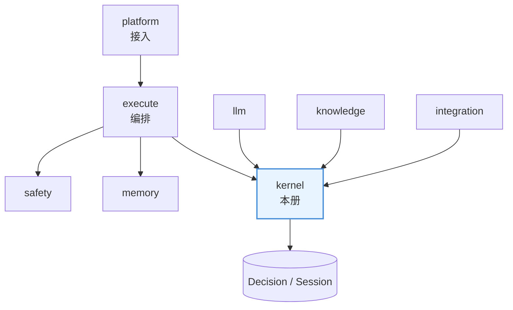
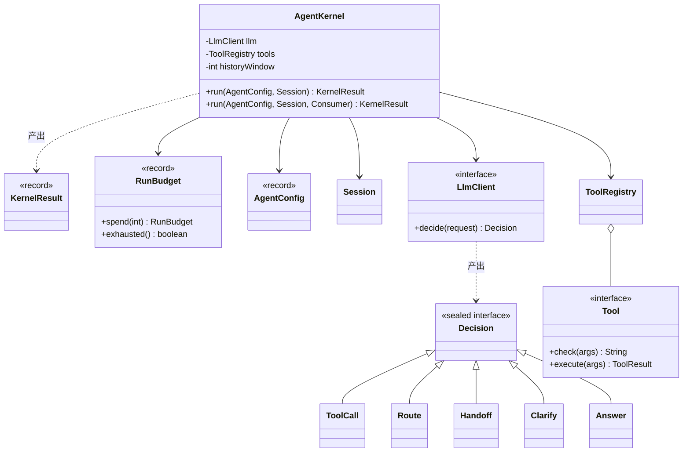
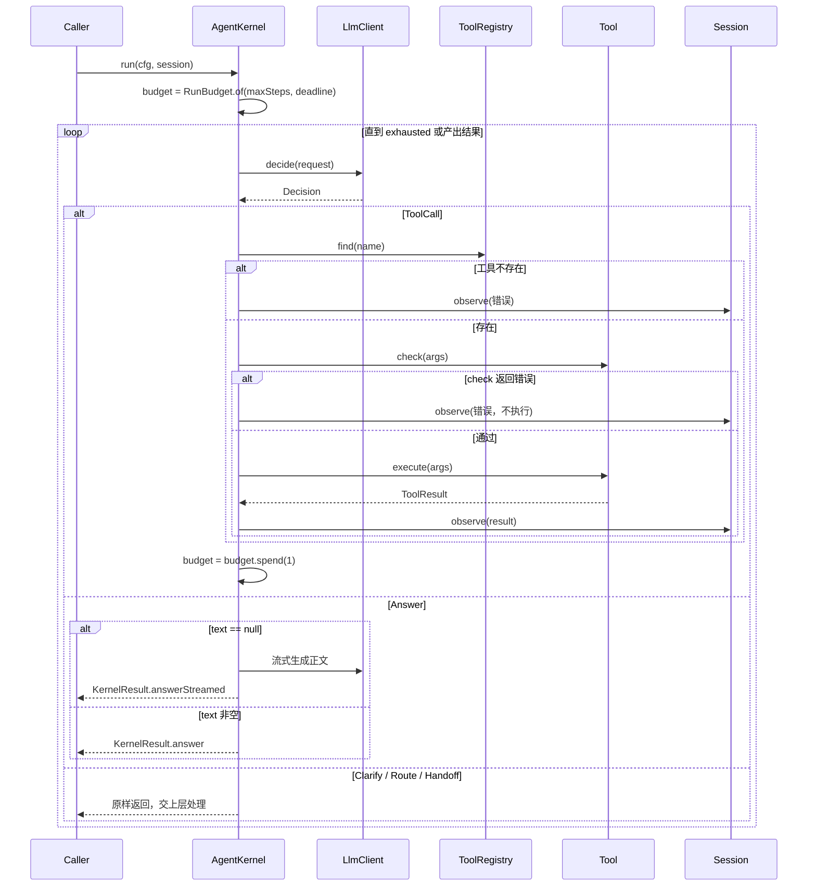

# 01 kernel · 详细实现设计

模块：`com.health.agent.kernel`　｜　依赖：无（最低层）
职责：单 agent 的执行循环与契约定义

---

## 1. 职责与边界

### 1.1 做什么

- 定义"一个 agent 一次决策"的契约（`Decision`）
- 跑"决策 → 工具 → 再决策"的循环，直到产出回答或追问
- 管理单轮的步数与时间预算

### 1.2 不做什么

| 不做 | 归属 |
|---|---|
| 判断该交给谁 | `execute/AgentRuntime` |
| 处理交接链 | `execute/AgentRuntime` |
| 组装 prompt | `execute/ExecuteAgents` |
| 落库 | `platform` |

**kernel 不认识 doctor、pharma 这些名字**。它只知道"有个 agent，名字是个字符串"。加一个新能力不需要改 kernel。

### 1.3 一条红线

**`Tool.check` 必须在 `Tool.execute` 之前调用。** 先验证后执行——副作用一旦发生，再报错就晚了。

### 1.4 在整体中的位置



kernel 是**被依赖最多的模块**，所以它的接口一旦改动，影响面最大。这也是它必须"不认识业务"的原因。

---

## 2. 类清单

### 2.1 类关系



### 2.2 清单

| 类 | 职责 | 约行数 |
|---|---|---|
| `api.Decision` | 五类决策的 sealed interface | 90 |
| `api.KernelResult` | 决策的执行结果 | 45 |
| `api.RunBudget` | 步数与时间预算 | 35 |
| `api.AgentConfig` | 单个 agent 的配置 | 50 |
| `domain.Session` | 会话（消息、租户、当前持有者） | 155 |
| `domain.Message` | 一条消息 | 40 |
| `domain.MessageSink` | 流式输出接口 | 20 |
| `app.AgentKernel` | 执行循环 | 200 |
| `infra.LlmClient` | 模型调用接口 | 60 |
| `infra.Tool` | 工具协议 | 30 |
| `infra.ToolRegistry` | 工具注册表 | 40 |
| `infra.ToolResult` | 工具结果 | 30 |
| `infra.Tracer` | 追踪接口 | 20 |
| `infra.KernelListener` | 步骤监听 | 20 |

---

## 3. 关键接口签名

### 3.1 Decision（五类，sealed）

```java
public sealed interface Decision
        permits Decision.ToolCall, Decision.Route, Decision.Handoff,
                Decision.Clarify, Decision.Answer {

    record ToolCall(String tool, Map<String, Object> args) implements Decision {}
    record Route(String target, String intent, double confidence,
                 String contextDigest, Map<String, Object> params,
                 List<Intent> remaining) implements Decision {}
    record Handoff(String target, String reason) implements Decision {}
    record Clarify(String question) implements Decision {}
    record Answer(String text) implements Decision {}   // text 可为 null，表示"该回答了，正文由内核流式生成"
    record Intent(String target, String intent) {}
}
```

**`Answer.text == null` 是有意义的**：模型输出 `{"decision":"ANSWER"}` 不带正文时，内核再用流式生成一次。不能把整个 JSON 当回答发给用户。

### 3.2 KernelResult

```java
public record KernelResult(Kind kind, String text, Decision.Route route,
                           int steps, long elapsedMs, boolean streamed,
                           Decision.Handoff handoff) {
    public enum Kind { ANSWER, CLARIFY, ROUTE, HANDOFF, DEGRADED }

    static KernelResult answer(Decision.Answer a, int steps, long ms);
    static KernelResult answerStreamed(String text, int steps, long ms);
    static KernelResult handoff(Decision.Handoff h, int steps, long ms);
    static KernelResult clarify(Decision.Clarify c, int steps, long ms);
    static KernelResult route(Decision.Route r, int steps, long ms);
    static KernelResult degraded(String reason, int steps, long ms);
}
```

**`streamed=true` 时调用方不得重发 `text`**。字已经到用户眼前了，再发一遍就是重复。

### 3.3 RunBudget

```java
public record RunBudget(int maxSteps, long deadlineAt) {
    static RunBudget of(int maxSteps, long deadlineMs);
    boolean expired();          // 时间到
    boolean exhausted();        // 步数用完或时间到
    long remainingMs();
    RunBudget spend(int steps); // 返回新实例，不可变
}
```

**不可变**。每次 `spend` 返回新实例，避免跨轮共享状态。

### 3.4 AgentKernel

```java
public class AgentKernel {
    public AgentKernel(LlmClient llm, ToolRegistry tools, Tracer tracer);
    public AgentKernel(LlmClient llm, ToolRegistry tools, Tracer tracer, int historyWindow);

    public KernelResult run(AgentConfig cfg, Session session);
    public KernelResult run(AgentConfig cfg, Session session, Consumer<String> onToken);
    public KernelResult run(AgentConfig cfg, Session session, Consumer<String> onToken,
                            KernelListener listener);
}
```

### 3.5 Tool

```java
public interface Tool {
    String name();
    String description();
    String paramsSchema();                       // JSON Schema
    default String check(Map<String, Object> args) { return null; }  // null=通过
    ToolResult execute(Map<String, Object> args);
}
```

**`check` 返回非 null 时，错误说明直接喂给模型**，让它自己改参数。不要替它猜。

### 3.6 LlmClient

```java
public interface LlmClient {
    Decision decide(LlmRequest request);

    record LlmRequest(String model, String systemPrompt, List<Message> messages,
                      List<ToolSpec> tools, boolean stream, Consumer<String> onToken) {
        static LlmRequest of(String model, String systemPrompt, List<Message> messages);
    }
}
```

---

## 4. 依赖

```
kernel/api      → 无
kernel/domain   → 无
kernel/infra    → kernel/domain（Message）
kernel/app      → api + domain + infra
```

**kernel 不 import 任何 `com.health.agent` 之外的包**（除了 JDK 与 Jackson）。

---

## 5. 实现要点

### 5.1 执行循环



**注意两个分支**：

1. `ToolCall` 的 `check` 失败时，**只把错误喂回历史，不执行工具**。模型看到错误会自己改参数重试。
2. `Answer` 且 `text == null` 时，**内核再发起一次流式生成**。这是 `{"decision":"ANSWER"}` 不带正文的正常路径，不是异常。

伪代码：

```
run(cfg, session):
  budget = RunBudget.of(cfg.maxSteps, cfg.deadlineMs)
  loop:
    if budget.exhausted() → degraded("max_steps_reached")
    request = buildRequest(cfg, session)        // systemPrompt + 历史窗口 + 工具
    decision = llm.decide(request)
    switch decision:
      ToolCall  → check → execute → 结果写回 session → continue
      Answer    → text != null ? answer : 流式生成后 answerStreamed
      Clarify   → clarify
      Route     → route（交给上层处理）
      Handoff   → handoff（交给上层处理）
    budget = budget.spend(1)
```

**kernel 只返回 Route/Handoff，不执行它们**。执行在上层，因为上层才认识"目标是否存在"。

### 5.2 工具调用顺序

```
1. tool = registry.find(name)        // 找不到 → 错误喂回模型
2. err = tool.check(args)            // 非 null → 错误喂回模型，不执行
3. result = tool.execute(args)       // 执行
4. session.observe(result)           // 写回历史
```

**第 2 步不能省**。省了就是"先斩后奏"，参数错了副作用已经发生。

### 5.3 历史窗口

`historyWindow` 控制带多少条历史进 prompt。默认 20。

**不是轮次上限**。会话本身无限长，进 prompt 的部分有限。

### 5.4 边界处理

| 场景 | 处理 |
|---|---|
| 模型返回空 | `Answer(null)`，让上层流式重生成 |
| 模型返回非 JSON | 当作纯文本回答，链路不断 |
| 工具不存在 | 错误喂回模型，让它改 |
| `check` 返回错误 | 错误喂回模型，不执行 |
| 预算耗尽 | `degraded("max_steps_reached")` |
| 时间到 | `degraded("timeout")` |

---

## 6. 单测清单

| # | 测什么 | 输入 | 期望 |
|---|---|---|---|
| K-01 | 纯回答 | 模型返回 `ANSWER{text}` | `Kind.ANSWER`，`streamed=false` |
| K-02 | 空回答触发流式 | 模型返回 `ANSWER{}` | 调用流式生成，`streamed=true` |
| K-03 | 工具调用后继续 | 返回 `TOOL` 再 `ANSWER` | `steps=2`，工具结果进历史 |
| K-04 | 工具不存在 | 返回不存在的工具名 | 错误喂回，不抛异常 |
| K-05 | check 拦截 | `check` 返回错误 | `execute` 未被调用 |
| K-06 | 步数耗尽 | `maxSteps=2`，模型连续返回 TOOL | `Kind.DEGRADED`，reason=`max_steps_reached` |
| K-07 | 时间耗尽 | `deadlineMs=1` | `Kind.DEGRADED`，reason=`timeout` |
| K-08 | Route 不执行 | 返回 `ROUTE` | `Kind.ROUTE`，未做任何交接 |
| K-09 | 非 JSON 容错 | 模型返回纯文本 | `Kind.ANSWER`，文本原样 |
| K-10 | 预算不可变 | `budget.spend(2)` | 原实例 `maxSteps` 不变 |

**K-05 是红线测试**：它保证"先验证后执行"不被改坏。这条挂了，说明有人为了省事把 `check` 删了。
