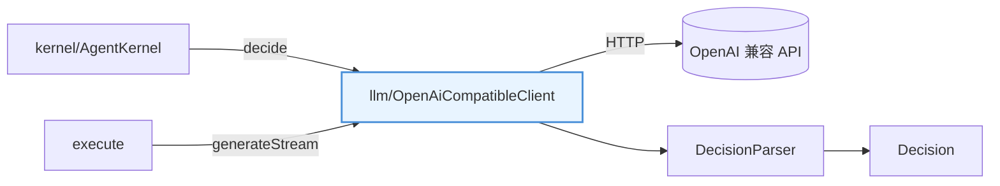
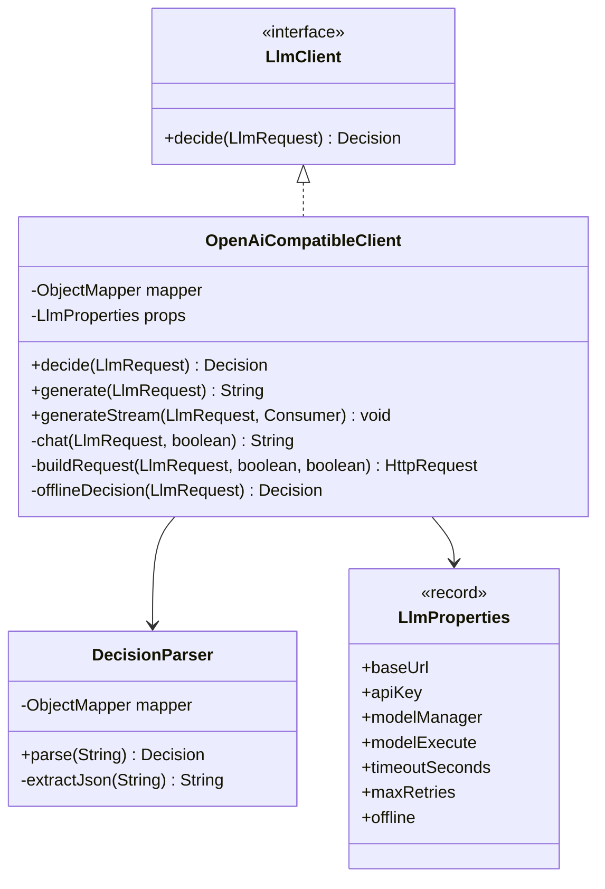
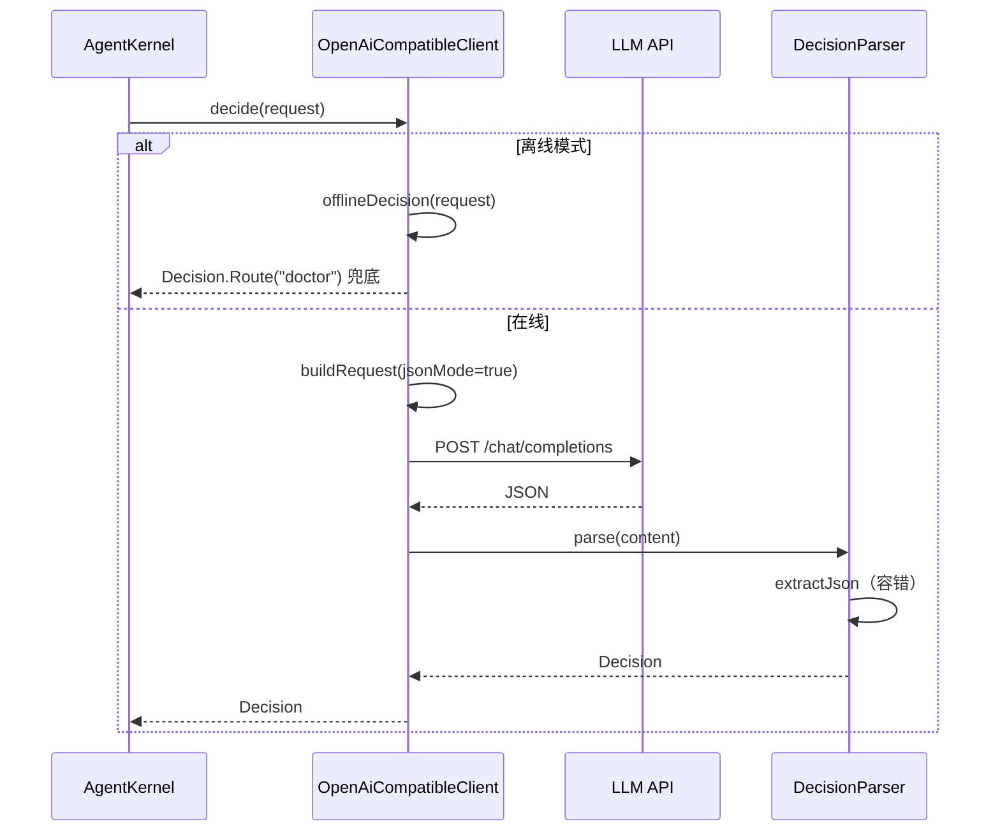

# 02 llm · 详细实现设计

模块：`com.health.agent.llm`　｜　依赖：kernel
职责：模型接入、决策解析、离线桩

---

## 1. 职责与边界

### 1.1 做什么

- 把 `LlmRequest` 变成 HTTP 请求，发出去，拿回 JSON
- 把 JSON 解析成 `Decision`
- 提供流式生成（正文逐 token 输出）

### 1.2 不做什么

| 不做 | 归属 |
|---|---|
| 组装 system prompt | `execute/ExecuteAgents` |
| 决定用哪个模型 | 调用方传 `model` 参数 |
| 处理交接 | `execute/AgentRuntime` |

**这一层不认识业务**。它只知道"发请求、解析 JSON"，不知道 doctor 和 pharma 的区别。

### 1.3 在整体中的位置



---

## 2. 类清单

### 2.1 类关系



### 2.2 清单

| 类 | 职责 | 约行数 |
|---|---|---|
| `LlmClient` | 模型调用接口（kernel 定义） | 60 |
| `OpenAiCompatibleClient` | OpenAI 兼容实现 + 离线桩 | 295 |
| `DecisionParser` | JSON → Decision，容错解析 | 90 |
| `LlmProperties` | 连接配置 | 45 |

---

## 3. 关键接口签名

```java
public class OpenAiCompatibleClient implements LlmClient {
    public OpenAiCompatibleClient(ObjectMapper mapper, LlmProperties props);

    @Override public Decision decide(LlmRequest request);
    public String generate(LlmRequest request);
    public void generateStream(LlmRequest request, Consumer<String> onToken);

    private String chat(LlmRequest request, boolean jsonMode);
    private HttpRequest buildRequest(LlmRequest request, boolean jsonMode, boolean stream);
    private Decision offlineDecision(LlmRequest request);
}

public final class DecisionParser {
    public DecisionParser(ObjectMapper mapper);
    public Decision parse(String rawContent);
}

public record LlmProperties(String baseUrl, String apiKey, String modelManager,
                            String modelExecute, int timeoutSeconds, int maxRetries,
                            boolean offline) {
    public boolean offlineOrNoKey();   // 无密钥或显式离线
}
```

**`LlmProperties` 的前缀是 `ha.llm`，不是 `llm`**。Spring 的 relaxed binding 会把环境变量 `LLM_API_KEY` 映射到 `llm.api-key`，而很多宿主环境（IDE、容器、CI）都注入了这个通用名，导致配置被静默覆盖。加前缀隔离。

---

## 4. 依赖

```
llm → kernel/api（Decision）
llm → kernel/infra（LlmClient、Message）
llm → Jackson、java.net.http
```

---

## 5. 实现要点

### 5.1 decide 的完整路径



### 5.2 JSON 容错

模型不总是输出纯 JSON。`extractJson` 处理三种情况：

| 情况 | 处理 |
|---|---|
| 包了 ` ```json ` 代码块 | 截取代码块内容 |
| 前后有多余文字 | 取第一个 `{` 到最后一个 `}` |
| 完全不是 JSON | 返回原文，`parse` 降级为 `Answer(原文)` |

**降级为 Answer 而不是报错**：链路不能因为格式不对就断。用户至少能看到一段话。

### 5.3 离线桩

```java
private Decision offlineDecision(LlmRequest request) {
    // 不是降级容错，是开发期脚手架——配了 key 就不会走到这里
    return new Decision.Route("doctor", "symptom", 0.5, "", Map.of(), List.of());
}
```

**注释要写清"这不是容错"**。否则后来人会以为它是生产降级路径，依赖它，然后线上出问题时才发现它只是返回固定路由。

### 5.4 边界处理

| 场景 | 处理 |
|---|---|
| HTTP 超时 | 抛 `RuntimeException`，由 kernel 转 `DEGRADED` |
| 4xx/5xx | 同上 |
| 响应体为空 | `Answer(null)`，让 kernel 流式重生成 |
| `choices` 为空 | `Answer(null)` |
| 工具调用参数非法 | 解析时丢弃该调用，不抛 |

### 5.5 流式

```
generateStream(request, onToken):
  POST with stream=true
  逐行读 SSE：
    "data: {...}" → 提取 delta.content → onToken.accept(delta)
    "data: [DONE]" → 结束
```

**必须处理 `[DONE]` 标记**。只按行读会在最后一行卡住。

---

## 6. 单测清单

| # | 测什么 | 输入 | 期望 |
|---|---|---|---|
| L-01 | 纯 JSON 解析 | `{"decision":"ANSWER","text":"hi"}` | `Answer("hi")` |
| L-02 | 代码块包裹 | ` ```json {...} ``` ` | 正常解析 |
| L-03 | 前后有文字 | `好的，这是结果：{...} 以上` | 正常解析 |
| L-04 | 完全非 JSON | `我不知道` | `Answer("我不知道")` |
| L-05 | 空响应 | `""` | `Answer(null)` |
| L-06 | ROUTE 带 remaining | 含 `remaining` 数组 | `Route.remaining` 有值 |
| L-07 | remaining 超量 | 3 条 | 截断为 2 条 |
| L-08 | 离线模式 | `offline=true` | 不发 HTTP，返回固定 Route |
| L-09 | 无密钥 | `apiKey=""` | 走离线桩 |
| L-10 | SSE 解析 | 多行 data + `[DONE]` | 拼接完整，正常结束 |

**L-04 是关键**：模型偶尔会拒绝输出 JSON。这时不能抛异常，要把它当普通回答。用户看到"我不知道"比看到"系统错误"好。
