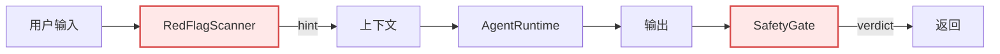
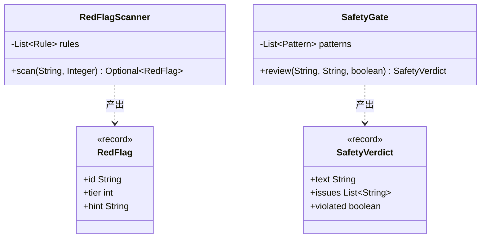
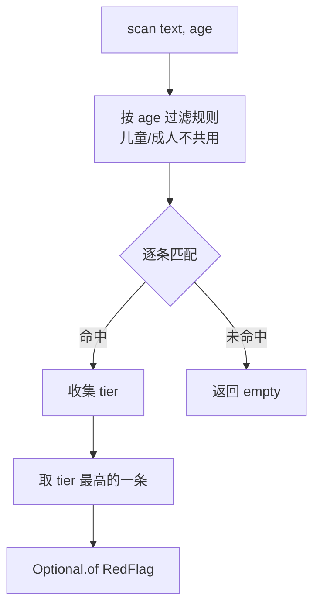
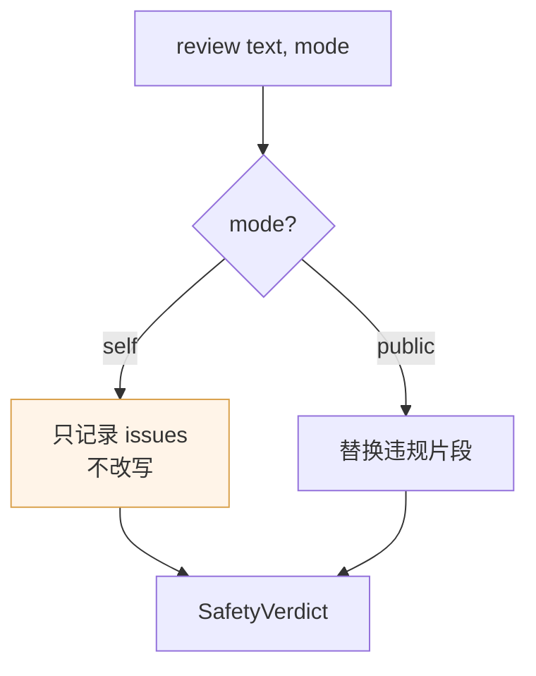

# 03 safety · 详细实现设计

模块：`com.health.agent.safety`　｜　依赖：无
职责：红旗识别、输出审查

---

## 1. 职责与边界

### 1.1 做什么

| 能力 | 类 | 时机 |
|---|---|---|
| 红旗识别 | `RedFlagScanner` | 路由前 |
| 输出审查 | `SafetyGate` | 生成后 |

### 1.2 不做什么

| 不做 | 归属 |
|---|---|
| 域外过滤 | `routing/OffTopicFilter` |
| 意图判断 | `execute` |
| 用 LLM 判断 | **本模块全部是规则** |

### 1.3 为什么不用 LLM

| 维度 | 规则 | LLM |
|---|---|---|
| 可解释 | 命中哪条规则一目了然 | 说不清为什么 |
| 可回归 | 改一条跑一遍 | 改 prompt 后行为漂移 |
| 延迟 | 毫秒级 | 百毫秒级 |
| 成本 | 零 | 每次调用都花钱 |

红旗是"漏一条就是漏诊"的场景，不能用概率性的东西。

### 1.4 在整体中的位置



---

## 2. 类清单

### 2.1 类关系



### 2.2 清单

| 类 | 职责 | 约行数 |
|---|---|---|
| `RedFlag` | 红旗定义（id / tier / hint） | 25 |
| `RedFlagScanner` | 规则匹配 | 120 |
| `SafetyGate` | 输出审查 | 180 |
| `SafetyVerdict` | 审查结果 | 20 |

---

## 3. 关键接口签名

```java
public record RedFlag(String id, int tier, String hint) {}

public class RedFlagScanner {
    public Optional<RedFlag> scan(String text, Integer age);
}

public class SafetyGate {
    public record SafetyVerdict(String text, List<String> issues, boolean violated) {}

    public SafetyVerdict review(String text, String mode, boolean strict);
}
```

**`scan` 返回 `Optional` 而不是 `null`**：调用方必须显式处理"没命中"，不会漏判空。

**`review` 返回改写后的 `text`**：即使 `self` 模式不改写，也返回原文，保证调用方不需要判空。

---

## 4. 依赖

```
safety → 无（除 JDK 与正则）
```

**safety 不依赖任何其他业务包**。它要被所有地方调用，一旦有依赖就会形成环。

---

## 5. 实现要点

### 5.1 红旗扫描



**只返回一条**。多条命中时给模型的信息越多，它越容易拼成"清单体"，反而冲淡重点。

### 5.2 命中后不套模板

```java
// 正确：注入提示，由模型组织语言
String hint = flag.map(RedFlag::hint).orElse("");
runtime.run(session, hint, onToken, sink);

// 错误：直接返回固定话术
if (flag.isPresent()) return "请立即拨打 120";
```

**为什么**：系统只看到一句话，不知道这是不是正在发生、是不是在转述别人的事、是不是电影情节。用模板替用户下结论，是拿"看起来很专业"换"实际上不负责"。

### 5.3 输出审查



| 检查项 | 模式 | 处理 |
|---|---|---|
| 断言式病名（"你这是 XX 病"） | 正则 | 记录 / 改写为"可能与该病相关" |
| 处方药推荐（"建议吃 XX"） | 正则 + 药品名 | 记录 / 删除推荐句 |
| 绝对化承诺（"一定能治好"） | 正则 | 记录 / 改写 |

**`self` 是默认**。因为流式输出下字已经到用户眼前，改写只作用于日志。

### 5.4 边界处理

| 场景 | 处理 |
|---|---|
| `text` 为空 | 返回空 verdict，不抛 |
| `age` 为 null | 只用成人规则 |
| 规则未加载 | 返回 empty（不阻断），记 ERROR 日志 |
| 正则超时 | 单条跳过，继续下一条 |

---

## 6. 单测清单

| # | 测什么 | 输入 | 期望 |
|---|---|---|---|
| S-01 | 红旗命中 | "胸口疼还冒冷汗" | `Optional` 有值，tier 正确 |
| S-02 | 红旗不命中 | "我有点感冒" | `Optional.empty()` |
| S-03 | 年龄段区分 | "孩子叫不醒" + age=3 | 命中儿童规则 |
| S-04 | 年龄段不误用 | "孩子叫不醒" + age=40 | 不命中儿童规则 |
| S-05 | 多条命中取最高 | 同时含两条不同 tier | 返回高 tier 那条 |
| S-06 | 空输入 | `""` | `Optional.empty()`，不抛 |
| S-07 | 断言病名检出 | "你这是肺炎" | `issues` 非空 |
| S-08 | 否定句不误判 | "不要自己吃阿莫西林" | 不算推荐 |
| S-09 | self 不改写 | mode=self + 违规文本 | `text` 与输入相同 |
| S-10 | 规则缺失不阻断 | 规则列表为空 | 返回 empty，不抛 |

**S-08 是最容易写错的**：`"不要吃阿莫西林"` 含药名但不构成推荐。判定必须看语境（推荐词 + 药名），不能只看药名。

**S-10 是可用性底线**：规则文件坏了不能让整个服务挂掉。安全模块挂了，用户连普通问题都问不了。
