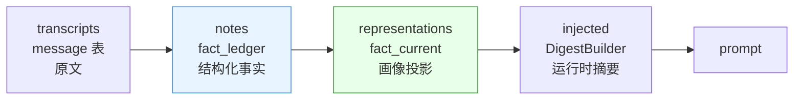
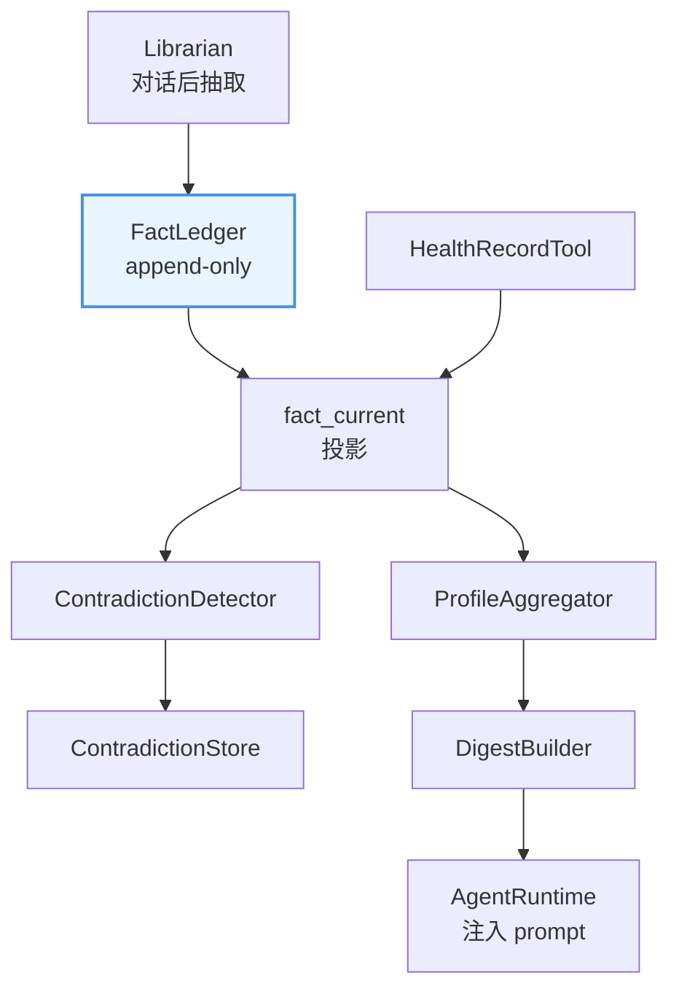
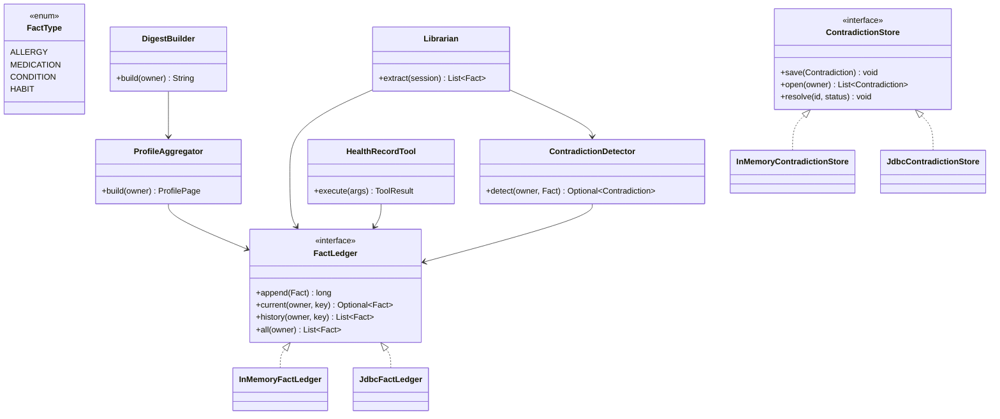
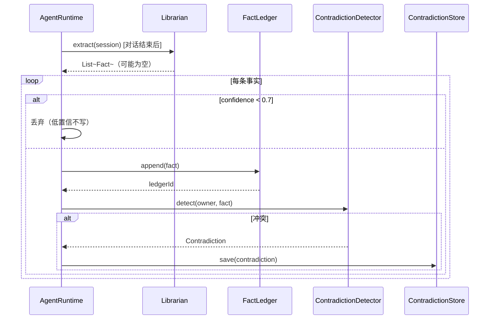
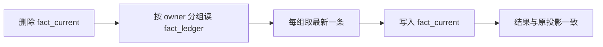
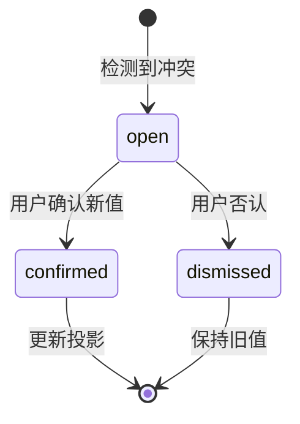

# 04 memory · 详细实现设计

模块：`com.health.agent.memory`　｜　依赖：kernel/domain
职责：事实账本、画像投影、矛盾检测、摘要注入

---

## 1. 职责与边界

### 1.1 做什么

| 能力 | 类 |
|---|---|
| 事实追加 | `FactLedger` |
| 画像投影 | `ProfileAggregator` / `ProfilePage` |
| 矛盾检测 | `ContradictionDetector` |
| 摘要注入 | `DigestBuilder` |
| 对话后抽取 | `Librarian` |
| 档案查询工具 | `HealthRecordTool` |

### 1.2 不做什么

| 不做 | 归属 |
|---|---|
| 决定"什么算重要事实" | `Librarian` 的 prompt |
| 判断用药禁忌 | `execute/pharma` |
| 覆盖式更新 | **永不覆盖** |

### 1.3 四层记忆



**为什么要分四层**：原文用于追溯，事实用于查询，投影用于快速读取，摘要用于注入。混在一起会让每个用途都变慢。

### 1.4 在整体中的位置



---

## 2. 类清单

### 2.1 类关系



### 2.2 清单

| 类 | 职责 | 约行数 |
|---|---|---|
| `FactLedger` | 账本接口 | 30 |
| `InMemoryFactLedger` | 内存实现（**仅单测用**） | 60 |
| `JdbcFactLedger` | 生产实现 | 223 |
| `FactType` | 事实类型枚举 | 20 |
| `ContradictionDetector` | 冲突检测 | 189 |
| `ContradictionStore` / 双实现 | 矛盾存储 | 80 |
| `ProfileAggregator` | 投影构建 | 90 |
| `DigestBuilder` | 摘要生成 | 110 |
| `Librarian` | 对话后抽取 | 196 |
| `HealthRecordTool` | 档案查询工具 | 130 |
| `HabitStore` / 双实现 | 习惯存储 | 100 |

---

## 3. 关键接口签名

```java
public interface FactLedger {
    long append(Fact fact);                          // 只插入，返回自增 ID
    Optional<Fact> current(String owner, String key); // 最新一条
    List<Fact> history(String owner, String key);     // 全部历史，按时间正序
    List<Fact> all(String owner);                     // 该用户全部当前事实
}

public record Fact(String owner, FactType type, String key, String value,
                   double confidence, String evidence, String sessionId) {}

public class ContradictionDetector {
    public Optional<Contradiction> detect(String owner, Fact incoming);
}

public record Contradiction(String owner, String kind, String severity,
                            String oldValue, String newValue, String status) {}

public class DigestBuilder {
    public String build(String owner);   // 生成注入 prompt 的摘要，≤800 字
}

public class Librarian {
    public List<Fact> extract(Session session);   // 从对话抽取事实，不直接落库
}
```

**`append` 返回 ID 而不是 void**：投影要指向账本 ID，没有返回值就无法建立关联。

**`DigestBuilder.build` 限 800 字**：摘要进 prompt，太长会挤占对话历史。

---

## 4. 依赖

```
memory → kernel/domain（Session、Message）
memory → 无其他业务包
```

**memory 不依赖 safety**。矛盾检测是数据一致性，不是安全判断。

---

## 5. 实现要点

### 5.1 写入路径



**低置信不写账本**（`confidence < 0.7`）。写入只会污染档案。宁可漏记，不可错记。

### 5.2 投影重建



**这是 append-only 的核心价值**：投影错了能重算，账本错了就永久错。

### 5.3 矛盾生命周期



**`open` 状态下不更新投影**。写进摘要首部"待确认"，用户确认后才改。

### 5.4 双实现的装配

`PersistenceConfig` 的默认值是 `jdbc`（`${ha.persistence.mode:jdbc}`），内存模式需要**显式开关** `ha.persistence.mode=memory`。

**设计理由**（写在类注释里，值得保留）：默认连不上就启动失败，不自动降级。降级到内存后产生的会话和事实一条都存不下——那是"看起来能用"的假状态，比启动失败更危险：用户以为记录下来了。

| 模式 | 触发 | 用途 |
|---|---|---|
| `jdbc`（默认） | 不配置 | 生产、本地联调 |
| `memory` | 显式设置 `ha.persistence.mode=memory` | 只改 prompt、不想起数据库时 |

**约束**：内存模式下启动日志必须打印"重启即丢"的警告。自动降级和主动选择是两件事，不能混。

### 5.5 边界处理

| 场景 | 处理 |
|---|---|
| `owner` 为空 | 抛 `IllegalArgumentException`，不写 |
| `evidence` 为空 | 允许（有些事实来自上下文而非单句） |
| 同一 `key` 连续写入相同值 | 跳过，不产生重复账本 |
| 矛盾超过 5 条未处理 | 摘要只显示最高 severity 的一条 |

---

## 6. 单测清单

| # | 测什么 | 输入 | 期望 |
|---|---|---|---|
| M-01 | 只追加不覆盖 | 同 key 写 3 次 | `history` 长度 3，`current` 是第 3 条 |
| M-02 | 投影可重建 | 删投影后重放 | 与原投影一致 |
| M-03 | 低置信不写 | `confidence=0.5` | 账本无新增 |
| M-04 | 值冲突检出 | 旧"青霉素过敏" / 新"青霉素不过敏" | `Contradiction` 非空 |
| M-05 | 时间冲突检出 | 互斥时间段 | `kind=temporal_conflict` |
| M-06 | 矛盾不自动覆盖 | 检出后 | `current` 仍是旧值 |
| M-07 | 用户确认后更新 | `resolve(confirmed)` | `current` 变为新值 |
| M-08 | 摘要限长 | 大量事实 | 输出 ≤800 字 |
| M-09 | 摘要只含高置信 | 混合置信度 | 只出现 ≥0.7 的 |
| M-10 | 默认实现正确 | 启动后查配置 | 是 `JdbcFactLedger` |

**M-10 是针对双实现隐患的守门测试**。没有它，默认走内存的问题会潜伏到某次重启。

**M-06 是安全底线**：系统不能因为"用户这次说了不同的"就自动改档案。可能是口误、可能是记错，必须确认。
