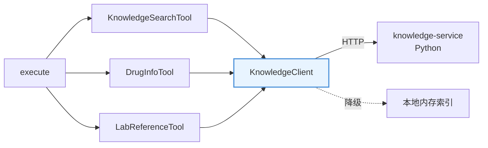
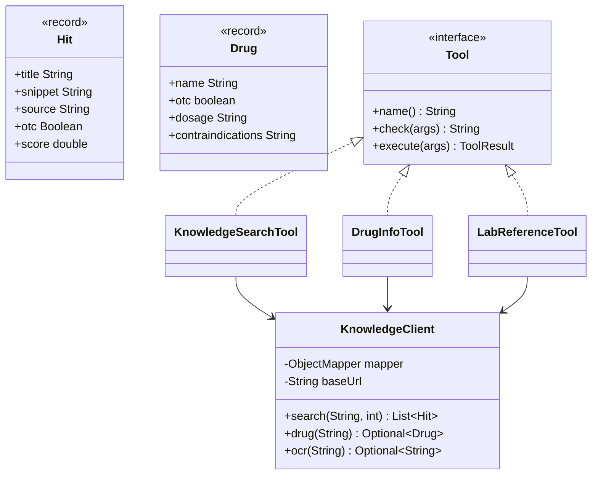
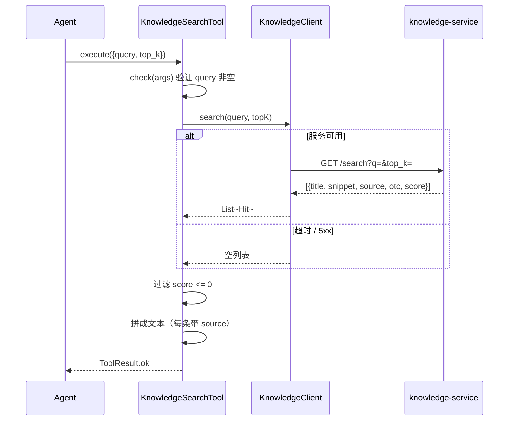
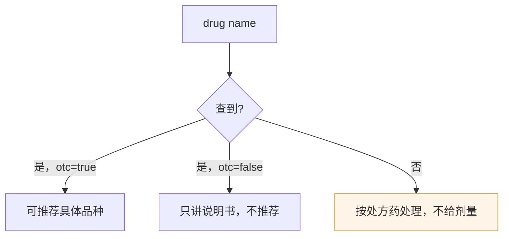

# 05 knowledge · 详细实现设计

模块：`com.health.agent.knowledge`　｜　依赖：kernel/infra
职责：知识检索客户端 + 三个工具封装

---

## 1. 职责与边界

### 1.1 做什么

| 类 | 职责 |
|---|---|
| `KnowledgeClient` | HTTP 客户端，调 Python 知识服务 |
| `KnowledgeSearchTool` | 通用检索工具 |
| `DrugInfoTool` | 药品信息工具 |
| `LabReferenceTool` | 指标参考区间工具 |
| `DepartmentIndex` | 科室映射（本地） |
| `ReferralIndex` | 转诊索引（本地） |

### 1.2 不做什么

| 不做 | 归属 |
|---|---|
| 检索排序算法 | `knowledge-service`（Python，见 11 册） |
| 决定用哪个工具 | `execute` 的 prompt |
| 判断药品能不能推荐 | `execute/pharma` |

**Java 侧只是客户端**。真正的检索逻辑（BM25 + kNN + RRF + 重排 + 相关性闸）在 Python 服务里，那一侧的设计见 **11 knowledge-service**。

### 1.3 在整体中的位置



---

## 2. 类清单

### 2.1 类关系



### 2.2 清单

| 类 | 职责 | 约行数 |
|---|---|---|
| `KnowledgeClient` | HTTP 客户端 | 170 |
| `KnowledgeSearchTool` | 检索工具 | 60 |
| `DrugInfoTool` | 药品工具 | 70 |
| `LabReferenceTool` | 指标工具 | 144 |
| `DepartmentIndex` | 科室映射 | 80 |
| `ReferralIndex` | 转诊索引 | 60 |

---

## 3. 关键接口签名

```java
public class KnowledgeClient {
    public KnowledgeClient(ObjectMapper mapper,
                           @Value("${knowledge.base-url}") String baseUrl);

    public List<Hit> search(String query, int topK);
    public Optional<Drug> drug(String name);
    public Optional<String> ocr(String imageBase64);

    public record Hit(String title, String snippet, String source,
                      Boolean otc, double score) {}
    public record Drug(String name, String title, String source, boolean otc,
                       String indications, String dosage, String contraindications) {}
}
```

**`Hit.otc` 是 `Boolean` 不是 `boolean`**：非药品类检索结果没有这个字段，用包装类型表示"不适用"。

**`drug` 返回 `Optional`**：查不到是正常情况，不是异常。

---

## 4. 依赖

```
knowledge → kernel/infra（Tool、ToolResult）
knowledge → Jackson、java.net.http
```

---

## 5. 实现要点

### 5.1 一次检索



**超时返回空列表，不抛异常**。抛了要在每层 catch，最后变成一堆空实现。

**过滤 `score <= 0`**：负分候选在重排时已判定为不相关，不应出现在结果里。

### 5.2 药品查询的三态



**查不到按处方药处理**，这是安全默认。宁可少推荐，不可错推荐。

### 5.3 降级

| 场景 | 行为 |
|---|---|
| 连接超时（500ms） | 返回空列表，回答里说明"没查到" |
| 5xx | 同上 |
| 返回非法 JSON | 同上，记 WARN |
| 服务未启动 | 启动时探测，标记 `degraded`，之后直接走降级 |

**启动时探测一次**。不要每个请求都试连，那会让每次请求都等超时。

### 5.4 边界处理

| 场景 | 处理 |
|---|---|
| `query` 为空 | `check` 返回错误，不执行 |
| `topK` > 50 | 截断到 50 |
| `snippet` 超长 | 截断到 300 字 |
| `source` 为空 | 保留条目，但标注"来源未知" |

---

## 6. 单测清单

| # | 测什么 | 输入 | 期望 |
|---|---|---|---|
| KN-01 | 正常检索 | mock 返回 3 条 | 全部返回，按 score 降序 |
| KN-02 | 负分过滤 | mock 含 `score=-1` | 被过滤 |
| KN-03 | 超时降级 | mock 超时 | 空列表，不抛 |
| KN-04 | 非法 JSON | mock 返回 `<html>` | 空列表，记 WARN |
| KN-05 | 药品 otc=true | mock `otc=true` | `Drug.otc=true` |
| KN-06 | 药品缺失字段 | mock 无 `otc` | `otc=false`（安全默认） |
| KN-07 | 药品查不到 | 404 | `Optional.empty()` |
| KN-08 | query 为空 | `""` | `check` 返回错误，未调用 HTTP |
| KN-09 | snippet 超长 | 1000 字 | 截断到 300 |
| KN-10 | 服务未启动 | 连接拒绝 | 降级，不重试 |

**KN-06 是安全相关的**：接口没返回 `otc` 字段时，必须按处方药处理。默认成 `true` 会导致错误推荐。
