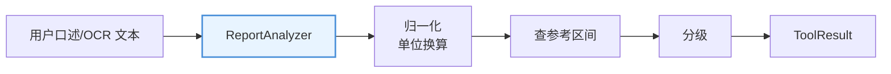

# 06 report · 详细实现设计

模块：`com.health.agent.report`　｜　依赖：无
职责：指标归一化与分级

---

## 1. 职责与边界

### 1.1 做什么

| 能力 | 现状 |
|---|---|
| 指标名识别 | ✅ |
| 参考区间查询 | ✅ |
| 单位换算 | ⚠️ 只走白名单 |
| 分级（正常/临界/异常） | ✅ |
| 趋势分析（对比历史） | ❌ 未实现 |
| 组合判断（多指标联看） | ❌ 未实现 |

**这是四个能力里最薄的一个**。写清楚现状，是为了验收时能明确说"这两个没做"，而不是含糊过去。

### 1.2 不做什么

| 不做 | 归属 |
|---|---|
| 影像判读 | 不支持，只说"需要医生看" |
| 疾病诊断 | 产品边界 |
| 用药调整 | `execute/pharma` |

### 1.3 在整体中的位置



---

## 2. 类清单

| 类 | 职责 | 约行数 |
|---|---|---|
| `ReportAnalyzer` | 归一化 + 分级 + 生成解读文本 | 120 |

**只有一个类**。当前没有独立的领域模型，区间数据存在知识库，运行时查询。

---

## 3. 关键接口签名

```java
public class ReportAnalyzer {
    public record Analysis(String indicator, Double value, String unit,
                           String level, String explanation) {}

    public Optional<Analysis> analyze(String indicator, double value, String unit);
}
```

**`level` 取值**：`normal` / `borderline` / `abnormal` / `unknown`。

**返回 `Optional`**：指标未收录时返回 empty，调用方必须显式处理。

---

## 4. 依赖

```
report → knowledge（查参考区间）
```

---

## 5. 实现要点

### 5.1 处理流程

```mermaid
flowchart TD
    A[指标名 + 数值 + 单位] --> B{指标名识别?}
    B -->|否| Z[unknown<br/>建议问医生]
    B -->|是| C{单位在白名单?}
    C -->|否| D[unknown<br/>说"单位不认识"]
    C -->|是| E[换算为 canonical]
    E --> F{在区间内?}
    F -->|是| G[normal]
    F -->|否| H{超出幅度 ≤20%?}
    H -->|是| I[borderline]
    H -->|否| J[abnormal]

    style D fill:#fff4e8,stroke:#d9a04a
    style Z fill:#fff4e8,stroke:#d9a04a
```

### 5.2 临界定义

```
区间宽度 = ref_high - ref_low
临界上界 = ref_high + 0.2 × 区间宽度
临界下界 = ref_low  - 0.2 × 区间宽度
```

**必须有唯一定义**。没有定义时，不同人判同一个值得出不同结论，验收时无法对齐。

例：区间 4.0–10.0，宽度 6.0，20% = 1.2。所以 11.2 是临界上界，11.3 才是异常。

### 5.3 边界处理

| 场景 | 处理 |
|---|---|
| 单位未识别 | `level=unknown`，明确说"这个单位我不认识" |
| 指标未收录 | `level=unknown`，建议问医生，不猜区间 |
| 数值明显不合理（白细胞 130） | 先提示"可能是单位或录入问题" |
| 区间有人群差异 | 输出标注"参考区间因人群而异" |

**最后一条之前的一条很重要**：录入错误比罕见病常见得多。看到极端值先怀疑输入。

---

## 6. 单测清单

| # | 测什么 | 输入 | 期望 |
|---|---|---|---|
| R-01 | 正常值 | 白细胞 6.0（区间 4–10） | `level=normal` |
| R-02 | 临界上界 | 11.2 | `level=borderline` |
| R-03 | 异常下界 | 11.3 | `level=abnormal` |
| R-04 | 临界下界 | 2.8 | `level=borderline` |
| R-05 | 单位未识别 | "3 个/HP" | `level=unknown` |
| R-06 | 指标未收录 | "某某新指标" | `Optional.empty()` |
| R-07 | 极端值提示 | 130 | `explanation` 含"录入"或"单位" |
| R-08 | 单位换算 | 13.5 g/dL → g/L | 135.0 |

**R-02/R-03 是边界测试**：只测中间值发现不了阈值写错。临界与异常的分界必须逐值测。
