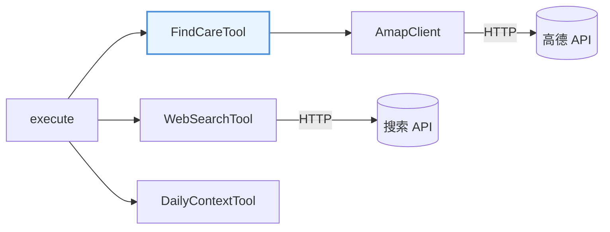
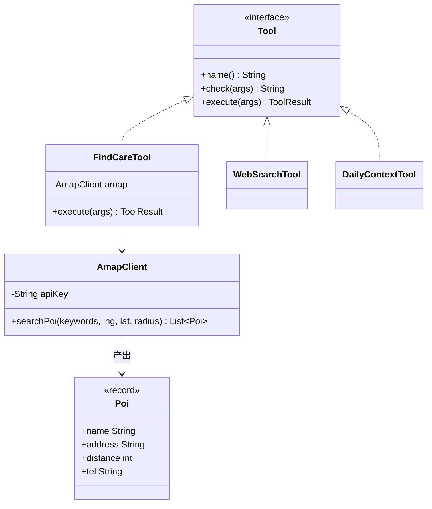
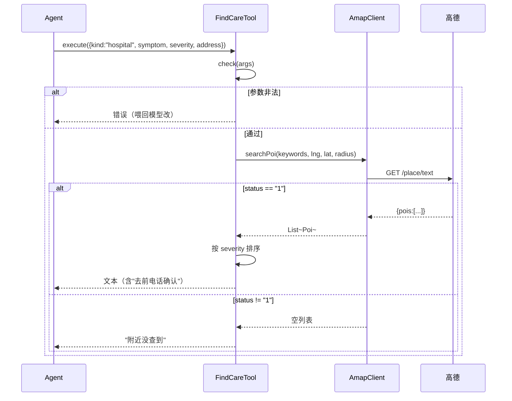

# 07 integration · 详细实现设计

模块：`com.health.agent.integration`　｜　依赖：kernel/infra
职责：外部服务适配（高德、搜索、日期）

---

## 1. 职责与边界

### 1.1 做什么

| 类 | 外部服务 | 工具名 |
|---|---|---|
| `AmapClient` | 高德 POI | — |
| `FindCareTool` | 经 `AmapClient` | `find_care` |
| `WebSearchTool` | 搜索 API | `web_search` |
| `DailyContextTool` | 本地计算 | `daily_context` |

### 1.2 不做什么

| 不做 | 归属 |
|---|---|
| 判断该挂什么科 | `knowledge/DepartmentIndex` |
| 判断医院好不好 | 无数据源，不做 |
| 号源、库存 | 高德不提供，不编 |

### 1.3 在整体中的位置



---

## 2. 类清单

### 2.1 类关系



### 2.2 清单

| 类 | 职责 | 约行数 |
|---|---|---|
| `AmapClient` | 高德 POI 客户端 | 236 |
| `FindCareTool` | 找医院/药店 | 159 |
| `WebSearchTool` | 联网搜索 | 162 |
| `DailyContextTool` | 日期/节气/天气 | 167 |

---

## 3. 关键接口签名

```java
public class AmapClient {
    public List<Poi> searchPoi(String keywords, Double lng, Double lat, int radius);

    public record Poi(String name, String address, int distance, String tel) {}
}

public class FindCareTool implements Tool {
    @Override public String name() { return "find_care"; }
    @Override public String check(Map<String, Object> args);   // 校验 kind/severity 枚举
    @Override public ToolResult execute(Map<String, Object> args);
}
```

**`searchPoi` 返回空列表而不是 null**：调用方不需要判空，直接遍历。

---

## 4. 依赖

```
integration → kernel/infra（Tool、ToolResult）
integration → Jackson、java.net.http
```

---

## 5. 实现要点

### 5.1 一次找医院



### 5.2 排序规则

| severity | 排序依据 |
|---|---|
| `mild` | 距离优先 |
| `severe` | 等级优先（三甲/专科），同等级再按距离 |

**重症不能只按距离排**。把肿瘤病人推荐到楼下社区医院是害人。

### 5.3 输出必须带的话

```
"附近有这几家，去之前建议打电话确认。"
```

**固定输出，不靠模型发挥**。营业时间、科室设置都可能变，这句话是免责的核心。

### 5.4 边界处理

| 场景 | 处理 |
|---|---|
| `status != "1"` | 按失败处理，不解析 `pois` |
| `pois` 为空 | 返回"没查到"，建议扩大范围 |
| 无位置 | 只给科室，不调 POI |
| `tel` 为空 | 输出"电话未提供" |
| 超时（2s） | 重试 1 次，仍失败则降级 |

---

## 6. 单测清单

| # | 测什么 | 输入 | 期望 |
|---|---|---|---|
| I-01 | 正常返回 | mock 3 条 POI | 全部返回，带电话 |
| I-02 | status 失败 | `status="0"` | 空列表，不解析 |
| I-03 | 空结果 | `pois=[]` | "没查到" |
| I-04 | 无位置不调用 | 无 lng/lat | 不发起 HTTP |
| I-05 | 重症优先三甲 | severity=severe | 首条为三甲 |
| I-06 | 轻症按距离 | severity=mild | 按 distance 升序 |
| I-07 | 固定提示语 | 任意成功返回 | 含"电话确认" |
| I-08 | 超时降级 | mock 超时 | 空列表，不抛 |
| I-09 | 非法参数 | kind="xxx" | `check` 返回错误 |

**I-05 与 I-06 是同一个方法的两条路径**，必须分别测。只测一条会漏掉排序逻辑写反的情况。

**I-09 验证 `check` 生效**：非法枚举不该进入执行。
