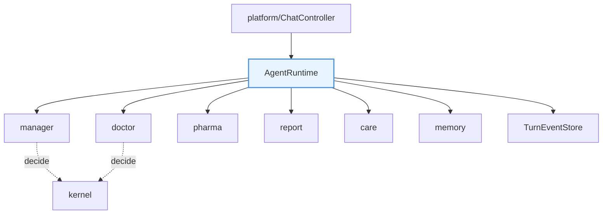
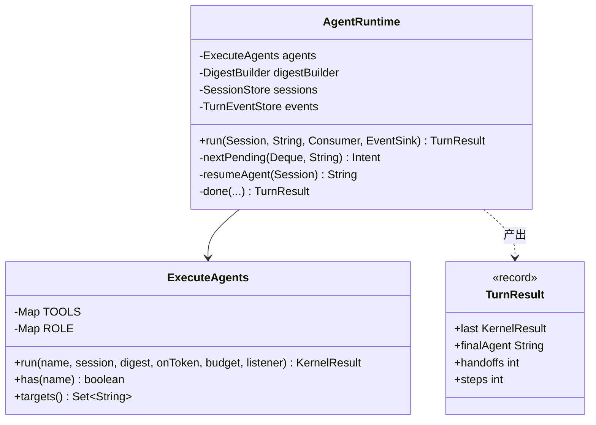
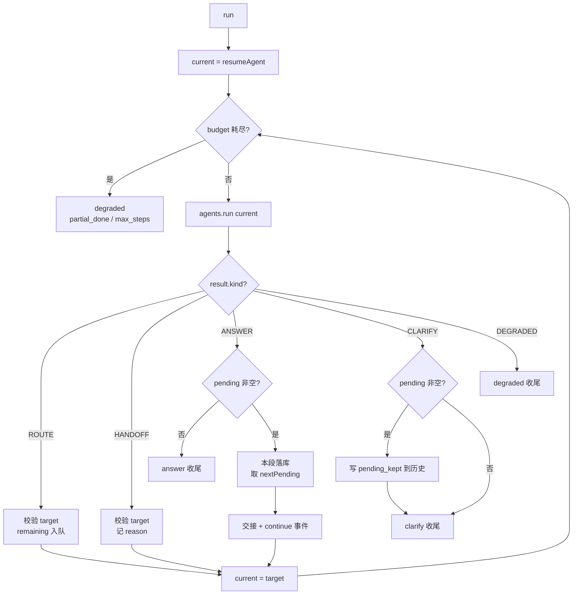
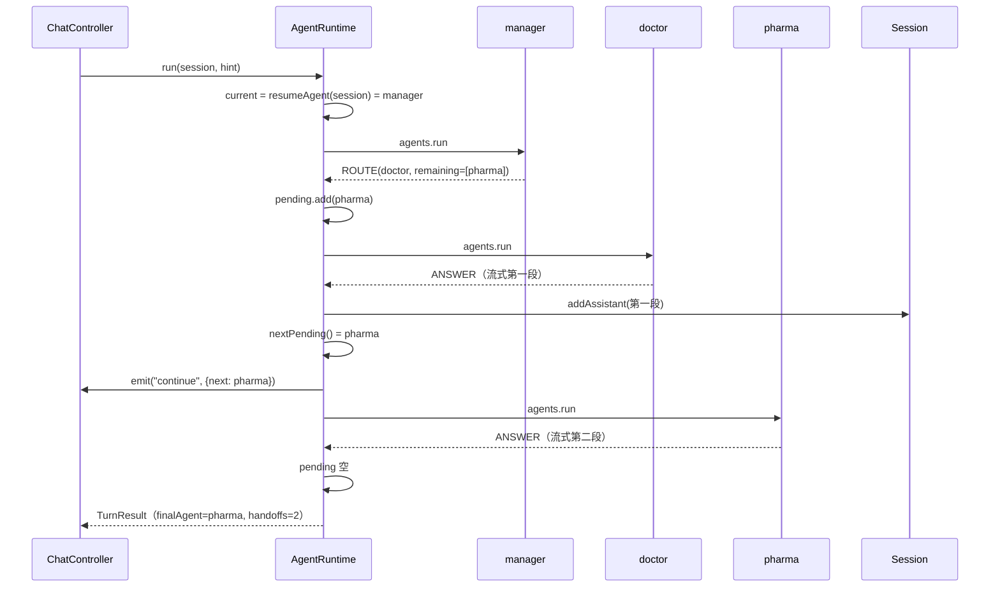

# 08 execute · 详细实现设计

模块：`com.health.agent.execute`　｜　依赖：kernel、memory、safety、llm
职责：一轮对话的编排（交接链、多意图队列、预算、事件）

---

## 1. 职责与边界

### 1.1 做什么

| 能力 | 类 |
|---|---|
| 交接链编排 | `AgentRuntime` |
| 多意图队列 | `AgentRuntime`（内存） |
| 能力注册与配置 | `ExecuteAgents` |
| 工具绑定 | `ExecuteAgents.TOOLS` |

### 1.2 不做什么

| 不做 | 归属 |
|---|---|
| 单 agent 内部循环 | `kernel/AgentKernel` |
| 判断该交给谁 | `manager` 的 prompt |
| HTTP / SSE | `platform` |

### 1.3 这一层为什么存在

允许交接之后，"谁来执行"不再是**一次性决定**，而是运行中反复发生的。

把这段循环塞进 `ChatController` 会让控制器同时管 HTTP、SSE、路由、预算、事件落库，谁也读不懂；塞进 kernel 又违反"内核不认识业务"。

### 1.4 在整体中的位置



---

## 2. 类清单

### 2.1 类关系



### 2.2 清单

| 类 | 职责 | 约行数 |
|---|---|---|
| `AgentRuntime` | 编排循环 | 300 |
| `ExecuteAgents` | 能力注册、prompt 加载、工具绑定 | 200 |
| `TurnResult` | 一轮结果 | 20 |

---

## 3. 关键接口签名

```java
public class AgentRuntime {
    public record TurnResult(KernelResult last, String finalAgent, int handoffs, int steps) {}

    public TurnResult run(Session session, String extraContext,
                          Consumer<String> onToken, EventSink sink);

    /** 取下一个待办，跳过无效项 */
    private Decision.Intent nextPending(Deque<Decision.Intent> queue, String current);

    /** 上一轮的持有者，校验过才用 */
    private String resumeAgent(Session session);

    /** 统一收尾：写 turn_end 再返回 */
    private TurnResult done(EventLog log, EventSink sink, KernelResult result,
                            String agent, int handoffs, int spent, String status);
}

public class ExecuteAgents {
    public KernelResult run(String name, Session session, String digest,
                            Consumer<String> onToken, RunBudget budget,
                            KernelListener listener);
    public boolean has(String name);
    public Set<String> targets();
}
```

---

## 4. 依赖

```
execute → kernel（AgentKernel、Decision、KernelResult、RunBudget）
execute → memory（DigestBuilder）
execute → platform（SessionStore、TurnEventStore）
```

**注意**：`execute` 依赖 `platform` 的 `SessionStore`，这是个**反向依赖**（platform 在上层）。

当前用接口隔离，可接受；拆服务时必须把这个依赖改成仓储接口下沉到 kernel。

---

## 5. 实现要点

### 5.1 编排主循环



### 5.2 多意图的完整时序



**关键点**：第一段必须自己落库（`addAssistant`）。`ChatController` 只收最后一段，前面的不写进历史，下一轮谁都看不到自己说过什么。

### 5.3 resumeAgent

```java
private String resumeAgent(Session session) {
    String active = session.activeAgent();
    if (active != null && !active.isBlank() && agents.has(active)) {
        return active;
    }
    return "manager";
}
```

**为什么从上一轮持有者开始**：用户上一句在问药，这一句大概率还在问药。每轮都从 manager 重判，等于把已建立的上下文丢掉重来。

**代价**：意图漂移。上一轮是 pharma，这一轮问"要不要去医院"，pharma 可能不交接。这是已知取舍，靠 prompt 约束交接。

### 5.4 nextPending

```java
private Decision.Intent nextPending(Deque<Decision.Intent> queue, String current) {
    while (!queue.isEmpty()) {
        Decision.Intent it = queue.poll();
        if (it.target().isEmpty() || it.target().equals(current) || !agents.has(it.target())) {
            continue;   // 跳过三种无效项
        }
        return it;
    }
    return null;
}
```

跳过：没写目标的、目标就是当前 agent 的（刚答完）、目标不存在的。

**跳过而不是报错**：这是规划层的失误，不该让用户承担一轮失败。

### 5.5 预算耗尽

```java
boolean partial = !pending.isEmpty();
return new TurnResult(
    KernelResult.degraded(partial ? "partial_done" : "max_steps_reached", ...),
    current, handoffs, spent);
```

**区分两种结局**：

| 情况 | reason | 用户看到 |
|---|---|---|
| 真的卡住 | `max_steps_reached` | "需要多步处理" |
| 答了一半 | `partial_done` | "处理了一部分，剩下的请单独发" |

后者不该说"没找到答案"——用户明明已经看到一部分回答了。

### 5.6 交接校验

```java
if (!agents.has(target)) {
    String error = "target 不存在：" + target + "（可选：" + agents.targets() + "）";
    session.observe(ToolResult.error("handoff", error));   // 喂回模型
    continue;                                              // 不中断
}
```

**错误喂回模型，不替它猜目标**。猜错等于静默降级。

---

## 6. 单测清单

| # | 测什么 | 输入 | 期望 |
|---|---|---|---|
| E-01 | 单意图直出 | manager→doctor→ANSWER | `handoffs=1`，agents=[manager,doctor] |
| E-02 | 多意图串行 | ROUTE(doctor, remaining=[pharma]) | 两段都执行，`handoffs=2` |
| E-03 | 多段全落库 | 同上 | assistant 消息数 = 2 |
| E-04 | 无效 target | ROUTE("nonexistent") | 错误喂回，不中断 |
| E-05 | pending 跳过自身 | remaining 含当前 agent | 跳过，不重复执行 |
| E-06 | CLARIFY 保留剩余 | ROUTE + 首个 agent CLARIFY | 写 `pending_kept`，本轮结束 |
| E-07 | 预算耗尽（无剩余） | maxSteps 很小 | `max_steps_reached` |
| E-08 | 预算耗尽（有剩余） | 同上 + pending 非空 | `partial_done` |
| E-09 | 续接上一轮 | `activeAgent=pharma` | 从 pharma 开始，不含 manager |
| E-10 | continue 事件 | 多意图 | 发 `continue` 而非仅 `handoff` |

**E-03 是最容易漏的**：只测"两段都输出了"不够，必须验证两段都进了历史。

**E-09 是续接逻辑的守门测试**：它保证"不重新过 manager"这个设计没被改回去。
