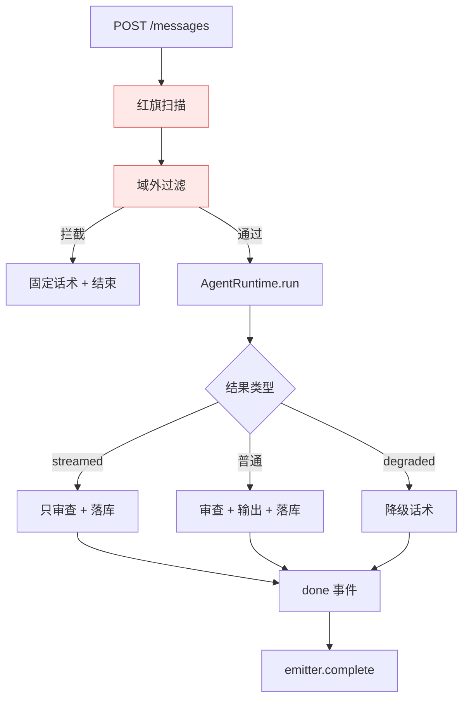
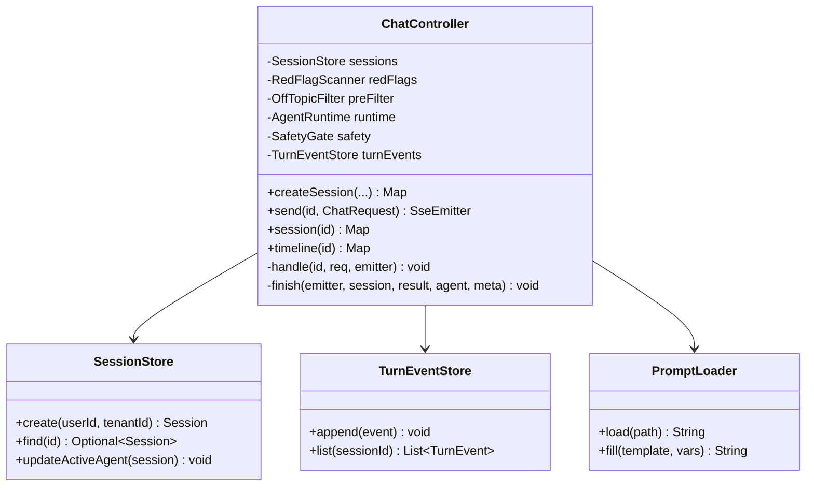
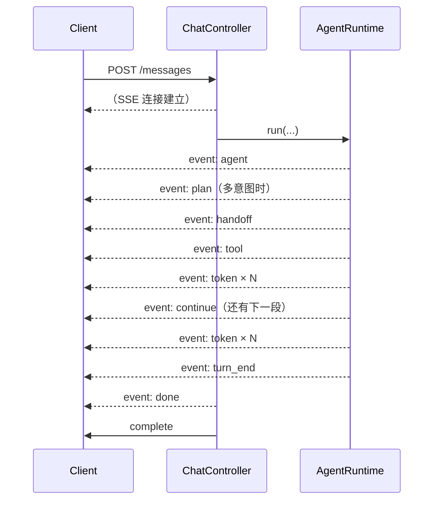
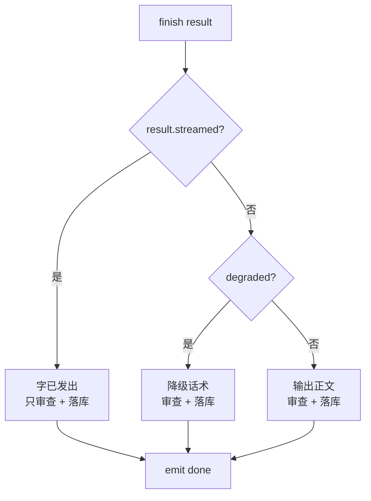

# 09 platform · 详细实现设计

模块：`com.health.agent.platform`　｜　依赖：execute、memory、safety
职责：HTTP 接入、SSE 输出、会话与事件持久化

---

## 1. 职责与边界

### 1.1 做什么

| 类 | 职责 |
|---|---|
| `ChatController` | 会话接口、SSE、一轮请求的完整链路 |
| `SessionStore` | 会话创建、查找、当前持有者更新 |
| `TurnEventStore` | 事件落库、按轮查询 |
| `PromptLoader` | prompt 加载、片段展开 |
| `MemoryController` | 档案查询（后台） |

### 1.2 不做什么

| 不做 | 归属 |
|---|---|
| 路由判断 | `execute` |
| 业务规则 | 各域 |
| 评测 | `evaluation` |

### 1.3 一轮请求的完整链路



**顺序不能改**：红旗必须在域外过滤之前，域外过滤必须在编排之前。安全优先于一切。

---

## 2. 类清单

### 2.1 类关系



### 2.2 清单

| 类 | 职责 | 约行数 |
|---|---|---|
| `ChatController` | 接入 + SSE + 链路编排 | 314 |
| `SessionStore` | 会话存储 | 90 |
| `TurnEventStore` | 事件存储 | 80 |
| `PromptLoader` | prompt 加载 + include 展开 | 70 |
| `MemoryController` | 档案后台接口 | 120 |

---

## 3. 关键接口签名

```java
@RestController
@RequestMapping("/api/v1")
public class ChatController {

    @PostMapping("/sessions")
    public Map<String, Object> createSession(
            @RequestHeader(value = "X-Tenant-Id", required = false) String tenantId,
            @RequestBody(required = false) CreateRequest request);

    @PostMapping(value = "/sessions/{id}/messages",
                 produces = MediaType.TEXT_EVENT_STREAM_VALUE)
    public SseEmitter send(@PathVariable String id, @RequestBody ChatRequest request);

    @GetMapping("/sessions/{id}")
    public Map<String, Object> session(@PathVariable String id);

    @GetMapping("/sessions/{id}/timeline")
    public Map<String, Object> timeline(@PathVariable String id);

    public record ChatRequest(String text, Integer age, String imageBase64) {}
}
```

---

## 4. 依赖

```
platform → execute（AgentRuntime）
platform → memory（DigestBuilder、Librarian）
platform → safety（RedFlagScanner、SafetyGate）
platform → routing（OffTopicFilter）
```

**platform 是唯一允许依赖所有层的模块**。它是组装点。

---

## 5. 实现要点

### 5.1 SSE 事件序列



### 5.2 finish 的三个分支



**`streamed=true` 时不能重发正文**。字已经到用户眼前，再发一遍就是重复。

### 5.3 流式与 Safety 的矛盾

```
流式：token 逐字发出 → 用户已看到 → 审查在最后 → 只能记录不能改写
```

**这是架构层面的已知缺陷**，不是实现疏漏。

| 模式 | 影响 |
|---|---|
| `self`（默认） | 只记录，无实际差异 |
| `public` | 改写只作用于日志，不作用于用户看到的 |

**切 `public` 之前必须改回缓冲输出**。这条写进代码注释，防止有人以为"切个模式就安全了"。

### 5.4 事件落库时机

| 事件 | 落库时机 |
|---|---|
| `turn_start` / `agent_start` | 立即 |
| `tool_start` / `tool_end` | 立即 |
| `answer` | 立即 |
| `turn_end` | 立即 |

**立即写，不攒批**。进程崩溃时，攒批会丢掉最后一轮的全部事件——而那一轮正是出问题的那轮。

### 5.5 边界处理

| 场景 | 处理 |
|---|---|
| 会话不存在 | 404 |
| `text` 为空 | 400 |
| 客户端断开 | 捕获异常，`emitter.complete()`，不重试 |
| 异常 | 发 `error` 事件，不发 `completeWithError`（会导致二次报错） |

---

## 6. 单测清单

| # | 测什么 | 输入 | 期望 |
|---|---|---|---|
| P-01 | 创建会话 | POST /sessions | 返回 `session_id` + `tenant_id` |
| P-02 | 域外拦截 | "今天天气" | 固定话术，无 `agent` 事件 |
| P-03 | 红旗注入 | "胸口疼冒冷汗" | hint 进上下文，非模板回复 |
| P-04 | SSE 事件完整 | 正常问诊 | agent→token→turn_end→done |
| P-05 | 多段不重复 | 多意图 | 两段 token 不重复 |
| P-06 | 降级话术 | 模拟超时 | "处理超时了" |
| P-07 | 客户端断开 | 中途 close | 不抛未捕获异常 |
| P-08 | timeline 合并 | 2 轮对话 | 消息与事件按轮合并 |
| P-09 | prompt include 展开 | 加载 doctor | 无 `{{include:` 残留 |
| P-10 | 会话恢复 | 重启后 GET /sessions/{id} | 历史完整 |

**P-02 验证顺序正确**：域外请求不该产生任何 agent 事件，说明它在编排之前就被拦了。
