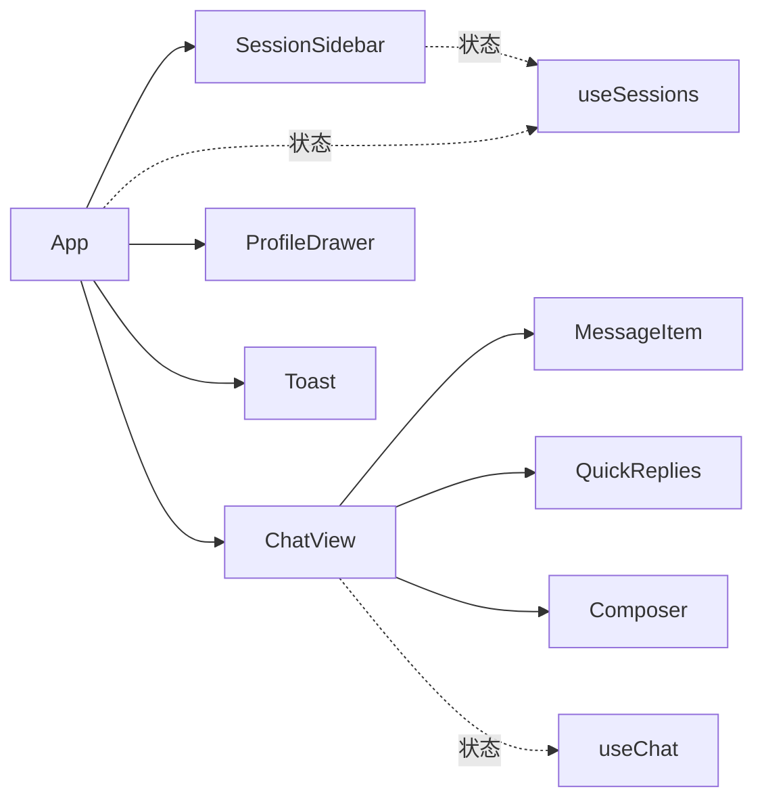
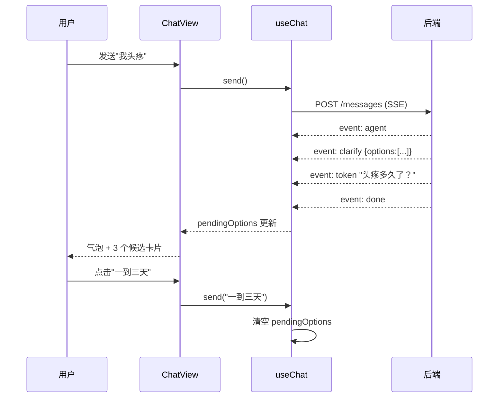
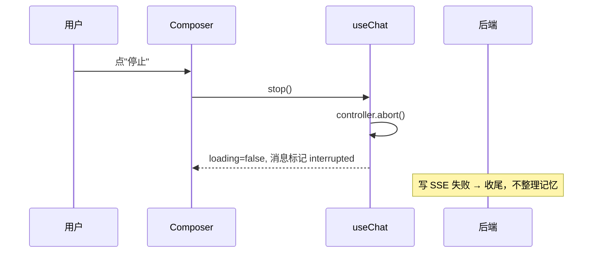
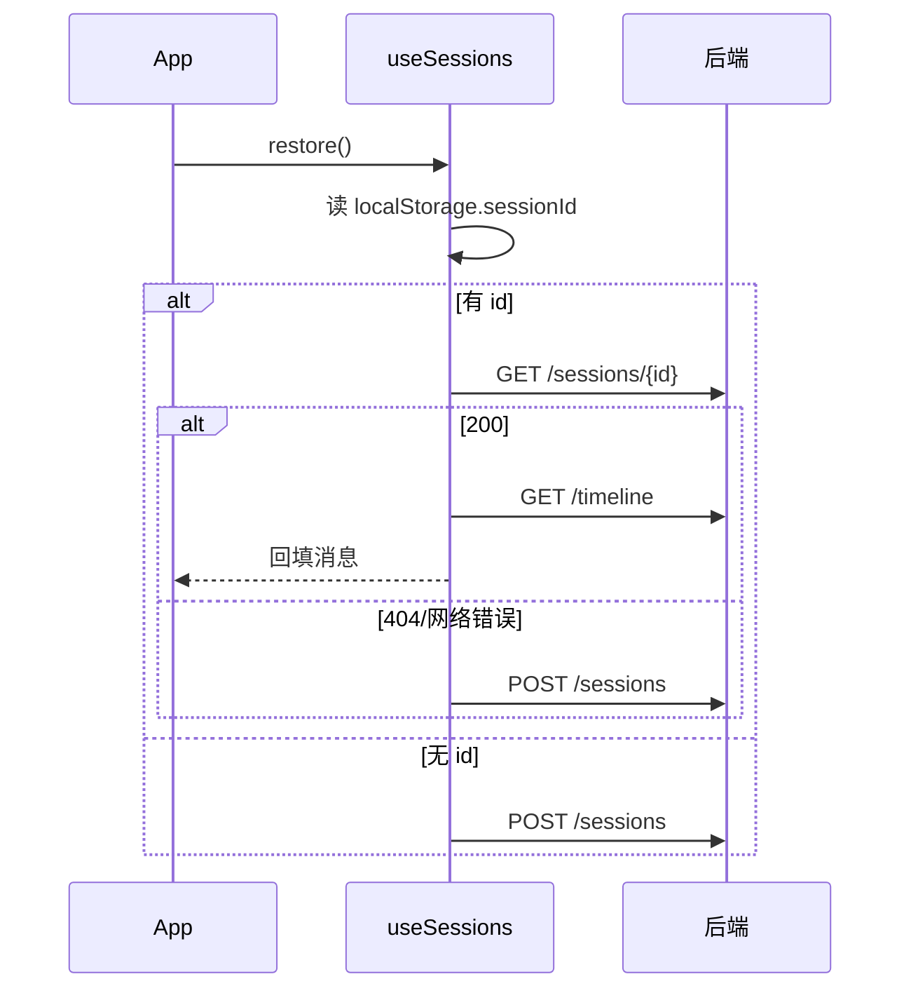

# 详细设计 · 前端交互层（12）

对应：`05-技术方案-交互能力.md`　｜　读者：写代码的人

---

## 1. 组件树

```
App.vue                     布局、视图切换、Toast 容器
├── SessionSidebar.vue      会话列表、新对话
├── ChatView.vue            对话视图
│   ├── MessageList          （内联在 ChatView，仅 v-for）
│   │   └── MessageItem     气泡、操作区、长按菜单
│   ├── QuickReplies        追问候选
│   └── Composer            输入、图片、发送/停止/重试
├── ProfileDrawer.vue       患者档案（原样搬运）
└── Toast.vue               轻提示
```



---

## 2. 状态与职责

### 2.1 `useChat`

```ts
interface ChatState {
  messages: ChatMessage[]      // 唯一的消息来源
  loading: boolean             // 正在生成
  error: string                // 最近一次失败原因，非空时 Composer 显示重试
  pendingOptions: string[]     // 当前追问的候选
}

function useChat(sessionId: Ref<string>) {
  send(text: string, image?: string): Promise<void>
  stop(): void                 // AbortController.abort()
  retry(): Promise<void>       // 重发最后一条用户消息
  clear(): void                // 切会话时清空
}
```

**关键点**

- `send` 内部维护 `AbortController`，每次新请求前 abort 上一个
- 流式 token 追加到"当前 assistant 消息"，用索引定位，不用 id
- 收到 `clarify` 事件时设置 `pendingOptions`，收到用户下一条消息时清空
- `stop()` 后把该条 assistant 消息标记 `interrupted: true`，气泡下方显示"已停止"

### 2.2 `useSessions`

```ts
interface SessionSummary {
  id: string
  turns: number
  preview: string
  updatedAt: string
}

function useSessions() {
  sessions: Ref<SessionSummary[]>
  currentId: Ref<string>
  load(): Promise<void>        // GET /sessions?userId=local
  createNew(): Promise<void>   // POST /sessions
  switchTo(id: string): Promise<void>
  restore(): Promise<void>     // 从 localStorage 恢复，失败则新建
}
```

**刷新恢复顺序**：`localStorage.sessionId` → `GET /sessions/{id}` 校验 → 成功则 `GET /timeline` 回填消息；失败（404/网络）则新建。

### 2.3 `useToast`

```ts
function useToast() {
  toasts: Ref<{id:number; text:string}[]>
  show(text: string, ms?: number): void
}
```

最多同时 3 条，2 秒自动消失。

---

## 3. 组件接口

### MessageItem

| prop | 类型 | 说明 |
|---|---|---|
| `message` | `ChatMessage` | 单条消息 |
| `index` | `number` | 用于定位 |
| `canFeedback` | `boolean` | 只有 assistant 消息为 true |

| emit | 参数 | 说明 |
|---|---|---|
| `feedback` | `(rating, reason?)` | 点赞/点踩/举报 |
| `quote` | `(text)` | 追问卡片点击（由 ChatView 处理） |

内部状态：`menuOpen`、`rating`（已提交的评级）、`speaking`。

**长按/右键**：`@contextmenu.prevent` + `@pointerdown` 计时 500ms。
移动端长按会触发系统选择，需要 `user-select: none`（气泡内文本仍可选中复制）。

### QuickReplies

| prop | 类型 |
|---|---|
| `options` | `string[]` |

| emit | 参数 |
|---|---|
| `pick` | `(text)` |

渲染在最后一条 assistant 消息下方；`options` 为空时不渲染。

### Composer

| prop | 类型 | 说明 |
|---|---|---|
| `loading` | `boolean` | 生成中，发送按钮变停止 |
| `error` | `string` | 非空显示重试 |
| `disabled` | `boolean` | 无会话时禁用 |

| emit | 参数 |
|---|---|
| `send` | `(text, imageBase64?)` |
| `stop` | `()` |
| `retry` | `()` |

### SessionSidebar

| prop | 类型 |
|---|---|
| `sessions` | `SessionSummary[]` |
| `currentId` | `string` |
| `open` | `boolean` |

| emit | 参数 |
|---|---|
| `new` | `()` |
| `select` | `(id)` |
| `close` | `()` |

---

## 4. 关键时序

### 4.1 追问 → 点卡片



### 4.2 停止生成



### 4.3 刷新恢复



---

## 5. 边界与错误

| 场景 | 处理 |
|---|---|
| 剪贴板 API 不可用 | `document.execCommand('copy')` 降级；再失败提示手动选择 |
| canvas `toBlob` 返回 null | 提示"生成失败，请重试"，不抛未捕获异常 |
| 语音合成不支持 | 隐藏"朗读"菜单项（`'speechSynthesis' in window`） |
| SSE 中途断开 | `error` 置为"连接中断"，该条消息标 `interrupted`，不重试 |
| 点踩原因未选 | 提交按钮禁用 |
| 反馈重复提交 | 后端 upsert，前端按钮进入已选态 |
| 会话切换时正在生成 | 先 `stop()` 再切，避免旧会话的 token 写进新会话 |
| localStorage 被禁用 | 捕获异常，退化为"每次刷新新建会话" |

---

## 6. 单测清单（后端）

| 编号 | 用例 | 期望 |
|---|---|---|
| W-01 | 解析 `CLARIFY` 带 options | options 原样保留，最多 4 个 |
| W-02 | 解析 `CLARIFY` 不带 options | options 为空列表，不报错 |
| W-03 | options 超过 4 个 | 截断到 4 |
| W-04 | 反馈 rating 非法 | 400 |
| W-05 | 反馈 session 不属于租户 | 404 |
| W-06 | 同一轮重复反馈 | 覆盖，不新增 |
| W-07 | 会话列表按租户隔离 | 只返回本租户 |
| W-08 | 会话列表 preview | 取首条 USER 消息，超 24 字截断 |

前端不引入测试框架（NFR-11），用 `vue-tsc` + `vite build` + 手工验证。
