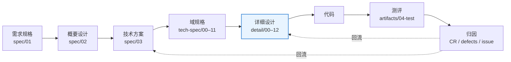

# 项目产物索引

这份索引只解决一件事：**现在哪份是准的，哪份已经过期，还差什么没验。**

最后更新：2026-11-26

---

## 0. 一条链

**增量需求走旁路**：`04 增量需求` → `05 技术方案`，同样落到 `detail/` 和测评。目前有两条旁路（交互能力 v1.3、图片粘贴 FR-21）。

---

## 1. 规格链（`docs/spec/`）

| # | 文件 | 版本 | 回答什么 | 下游 |
|---|---|---|---|---|
| 01 | `01-需求规格.md` | v1.2 | 做什么、不做什么、P0/P1 分级 | 02 |
| 02 | `02-概要设计.md` | v1.0 | 服务怎么拆、域怎么分、数据模型 | 03 |
| 03 | `03-技术方案.md` | v1.0 | 怎么落地：部署、选型、跨域契约 | tech-spec |
| 04 | `04-增量需求-交互能力.md` | v1.3 | 复制/反馈/分享/追问卡片/会话/可靠性 | 05 |
| 05 | `05-技术方案-交互能力.md` | v1.3 | 上述需求的实现方案 | detail/12 |
| 06 | `06-增量需求-图片粘贴.md` | FR-21 | 图片粘贴与 OCR 链路 | 07 |
| 07 | `07-技术方案-图片粘贴.md` | FR-21 | 上述需求的实现方案 | detail/12、11 |

### 域规格 `spec/tech-spec/`（00–11）

按**业务域**切，不按代码包切。回答"每个域具体怎么实现、怎么测、边界在哪"。

00 总览与约定 ｜ 01 症状咨询 ｜ 02 医药知识 ｜ 03 检查报告 ｜ 04 就医路径 ｜ 05 记忆与档案 ｜ 06 安全与合规 ｜ 07 运营与质量 ｜ 08 跨域契约 ｜ 09 模块划分 ｜ 10 多租户 ｜ 11 评测与观测

---

## 2. 详细设计（`docs/spec/detail/`，13 册）

按**实现单元**切。回答"有哪些类、方法签名长什么样、边界怎么处理"。

| 册 | 覆盖 | 语言 |
|---|---|---|
| 00 | 总览与编码约定 | — |
| 01–10 | kernel / llm / safety / memory / knowledge / report / integration / execute / platform / evaluation | Java |
| 11 | knowledge-service（检索服务） | Python |
| 12 | web（前端交互层） | TypeScript |

**01–10 按依赖顺序**（前面先实现），11–12 是进程外的独立单元，排在后面。

---

## 3. 测评产物（`docs/artifacts/04-test/`）

| 文件 | 内容 | 状态 |
|---|---|---|
| `test-run-20261126.md` | 外循环执行报告，对运行中的 jar 发真实请求 | r9 基线 |
| `defects-20261126.md` | 缺陷单，六分类归因 | r9 |
| `acceptance-20261126.md` | 验收单，P0 逐条判定 | **FR-05 未验证** |
| `gate-20261126.md` | 门禁报告 | **r9 结论已过期，r14 未验证** |
| `l1-report-20261126.md` | L1 域过程评测集交付说明 | **被账户余额阻塞** |
| `smoke-20261126-r3.md` | 冒烟（最新一轮） | 有效 |
| `route-eval-pass3-r3.json` | 路由评测 Pass^3 | **19/19，可作基线** |
| `redflag-20261126.json` | 红旗扫描 30 正 / 20 负 | **50/50，可作基线** |
| `otc-20261126.json` | OTC 推荐抽检 | **无效**（`total=0`，探针没产出可判定结果） |
| `l1/l1-*-void-402.json` | 4 个域的 L1 过程评测 | **作废**（402 余额不足，`void` 就是这意思） |
| `route-eval-*.json`（其余 4 份） | 早期轮次 | 历史，被 pass3-r3 取代 |

**能当放行依据的只有两份**：`route-eval-pass3-r3.json`、`redflag-20261126.json`。其余要么过期、要么无效。

---

## 4. 归因产物（三层，别混用）

| 层 | 位置 | 回答 | 依据 |
|---|---|---|---|
| 代码级 | `03-coding/CR-20261126-00X.md` | 实现和详细设计对不对得上 | 对照 `detail/` 逐册检查 |
| 行为级 | `04-test/defects-20261126.md` | 跑起来的行为对不对 | 外循环真实请求 |
| 用户级 | `05-product/issue-*.md` | 用户实际遇到什么 | 现象 → 根因 → 修复 |

### CR 系列

| 编号 | 主题 | 结论 |
|---|---|---|
| 001 | 全量代码评审（71 文件 / 6917 行） | 4 个问题：3 修（P0 + P1 + 文档），1 记入技术债 |
| 002 | 拆出 llm-gateway | 通过（行为验证受余额阻塞） |
| 003 | 交互能力增量 | 通过（UI 待人工验证） |
| 004 | 图片粘贴 FR-21 | 通过（含一条模型能力限制） |
| 005 | 移除独立报告解读页 | 已移除 |

### 用户级问题

`issue-empty-sessions`（历史会话大量空标题）｜`issue-image-display`（图片不显示 + 报告识别失败无出路）｜`issue-streaming-stall`（流式卡顿）——三份均已修复。

`feature-gap.md` 是与小荷 AI 医生的逐项功能对照，不是问题记录，归在这里是因为它驱动需求。

`open-source-release.md` 记录开源发布前的脱敏范围（真实联系方式、云隧道地址）、未入库内容与遗留风险，不是产品问题，归在这里是因为它是一次交付动作的留痕。

---

## 5. 归档与数据

| 位置 | 内容 | 说明 |
|---|---|---|
| `03-coding/builds/` | 16 份迭代构建日志（r2–r17） | 过程留痕，不参与判定 |
| `03-coding/build-20261126.log` | 基线构建 | CR-001 的依据，**留在原位** |
| `test-data/` | 5000 题评测集（csv + md） | 两格式同源 |
| `docs/health-agent-design.md` | 早期整体设计（83KB，含 18 条 ADR） | 仍是 ADR 出处，但**不是当前规格**，规格以 `spec/` 为准 |
| `docs/dev-standards.md` | 开发规范 | 独立，不属于规格链 |

---

## 6. 当前状态（一句话）

**功能基本可用，但验证链断了。** 三条证据链同时缺：

1. **门禁**：r9 的六项结论被后续三处 prompt 改动推翻，r14 未重跑——现在没有任何一份"当前版本通过门禁"的记录。
2. **用药咨询（FR-05）**：OTC 评测 `total=0`，探针没抽出药名，等于这项从未验证过。而它恰好是安全红线（处方药不能推荐）。
3. **L1 过程评测**：跑批被余额阻塞，4 个域的结果全部作废，没有基线可比。

---

## 7. 已知问题（待处理）

| # | 问题 | 影响 |
|---|---|---|
| 1 | `es_store.py` / `reranker.py` 注释写"45 条文档"，实际 88 条 | `DROP_BELOW = -5` 的标定说明过期 |
| 2 | `/graph`、`/entities` 无调用方 | 图谱建好但没接进召回 |
| 3 | knowledge-service 无自动化测试 | 11 册第 6 节是待建清单 |

---

## 8. 怎么用这份索引

- **要改代码** → 从 `detail/` 找对应册，第 3 节是签名，第 5 节是边界。
- **要判断能不能发** → 只看 §3 里标"可作基线"的两份；其余一律不算证据。
- **要查某个 bug 是谁的责任** → 先看 `defects` 的六分类，再顺着分类去对应的 CR 或 issue。
- **要新增需求** → 照 `04`/`06` 的模式开增量文档，不要直接改 `01`。
