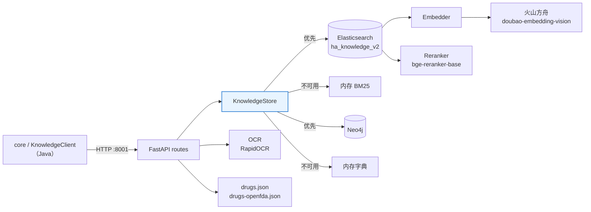
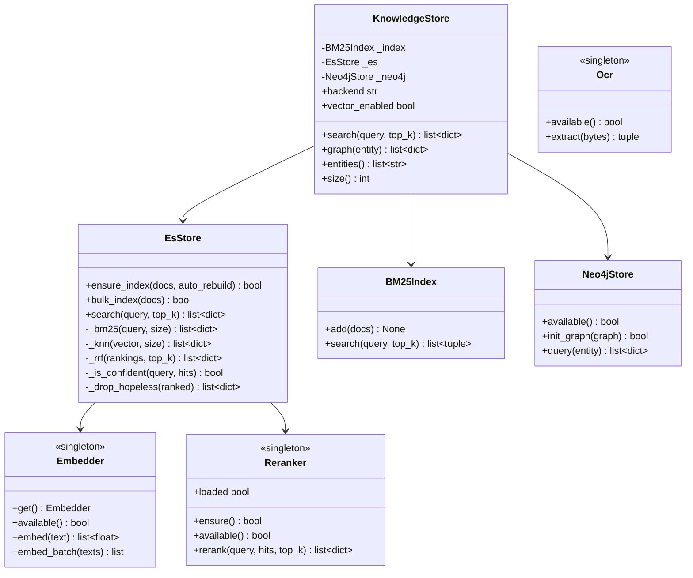
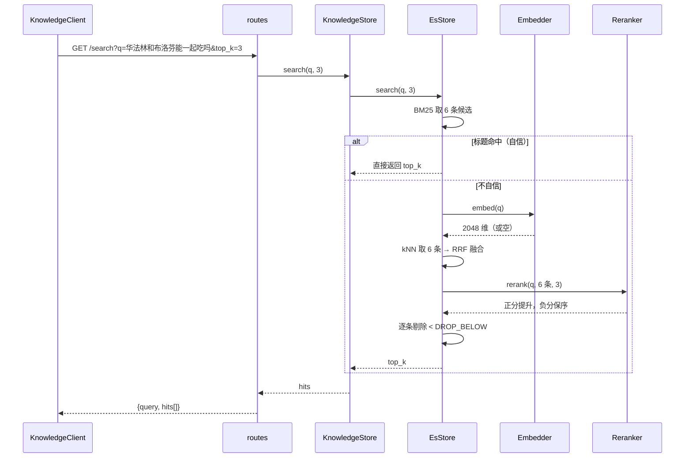

# 11 knowledge-service · 详细实现设计

服务：`knowledge-service`（Python / FastAPI）　｜　部署：独立进程，默认 `127.0.0.1:8001`
职责：混合检索、药品结构化查询、图谱一跳查询、图片 OCR
上游：`tech-spec/02-医药知识域.md`（规则与不变量）、`docs/health-agent-design.md` §7（检索策略的完整论证）
下游：`core` 的 `KnowledgeClient`（见 05 册）

---

## 1. 职责与边界

### 1.1 做什么

| 端点 | 能力 | 调用方 |
|---|---|---|
| `GET /search` | BM25 + kNN 混合检索，带相关性闸 | `KnowledgeClient.search` → `KnowledgeSearchTool` |
| `GET /drug` | 按药名返回结构化说明书字段 | `KnowledgeClient.drug` → `DrugInfoTool` |
| `POST /ocr` | 图片转文字，按行合并 | `KnowledgeClient.ocr` → 报告上传 |
| `GET /health` | 各后端就绪状态 | 启动探活、排障 |
| `GET /graph` | 实体的一跳关系（出边 + 入边） | **暂无调用方**（能力就绪，未接入 agent） |
| `GET /entities` | 图谱实体列表 | **暂无调用方**（仅手工调试） |

**图谱这两个端点是"有实现没入口"的状态**：Neo4j 初始化、白名单、双向查询都写了，但 Java 侧没有工具去调它。排障时看到 `/health` 里 `graph_backend: neo4j` 不要以为图谱已经参与回答——它没有。

### 1.2 不做什么

| 不做 | 归属 |
|---|---|
| 判断"这药能不能推荐" | `execute/pharma`（Java，看 `otc` 字段） |
| 解读报告、给诊断建议 | `report`（Java） |
| 决定用哪个工具、怎么拼 prompt | `execute`（Java） |
| 多轮对话、会话状态 | `platform`（Java） |

**这个服务是无状态的**。同一句话问两次，结果必须一样（除了重排模型未加载时的降级差异）。没有会话、没有缓存跨请求共享——只有 embedding 的查询缓存，且它不改变结果，只改变延迟。

### 1.3 在整体中的位置



**每个后端独立降级**。检索、图谱、向量、重排、OCR 任一不可用都不影响其余，`/health` 一次性报全。

---

## 2. 类清单

### 2.1 类关系



### 2.2 清单

| 类 / 模块 | 文件 | 职责 | 行数 |
|---|---|---|---|
| `routes` | `app/api/routes.py` | 6 个端点 + 响应模型 | 115 |
| `KnowledgeStore` | `app/store/memory_store.py` | 后端选择、启动探测、降级路由 | 139 |
| `EsStore` | `app/store/es_store.py` | 索引管理 + 三段检索 + 融合 | 337 |
| `BM25Index` | `app/retrieval/bm25.py` | 内存 BM25（字符 bigram） | 91 |
| `Embedder` | `app/retrieval/embedder.py` | 单例 + 无 key 时的 Noop 降级 | 80 |
| `VolcengineEmbedder` | `app/retrieval/volcengine_embedder.py` | 2048 维向量，带 LRU 缓存与熔断 | 116 |
| `Reranker` | `app/retrieval/reranker.py` | 交叉编码器重排，只提升正分 | 145 |
| `Neo4jStore` | `app/store/neo4j_store.py` | HTTP 事务接口 + 关系白名单 | 103 |
| `Ocr` | `app/ocr/ocr.py` | RapidOCR，按 y 坐标合并行 | 116 |
| `drugs` / `seed_data` | `app/store/` | 药品结构化数据与文档拼装 | 370 |

---

## 3. 关键接口签名

### 3.1 HTTP 契约

Java 侧只依赖这 6 个端点，字段名一旦改动就是破坏性变更。

| 端点 | 入参 | 出参 |
|---|---|---|
| `GET /search` | `q`（非空）、`top_k`（1–10，默认 3） | `{query, hits[]}` |
| `GET /drug` | `name`（非空） | `{found, title, source, ...说明书字段}` |
| `GET /graph` | `entity`（非空） | `{entity, edges[{relation, target}]}` |
| `GET /entities` | 无 | `{entities[]}` |
| `POST /ocr` | `{image_base64}` | `{ok, text, lines}` |
| `GET /health` | 无 | 各后端状态 |

`Hit` 的字段是契约的一部分：

```json
{
  "id": "drug-ibuprofen",
  "title": "布洛芬缓释胶囊",
  "snippet": "适应症……",
  "source": "示例说明书 v1",
  "score": 0.0164,
  "otc": true,
  "rerank_score": 1.51,
  "drug": { "name": "布洛芬", "dosage": "……" }
}
```

**`otc` 是 `bool | null`，`null` 不等于 `false`**。`null` 表示"非药品或未标注"，`false` 表示"确认是处方药"。Java 侧按 `false` 处理两者，但排查时必须能区分——所以字段不能省。Pydantic 默认丢弃未知字段，索引里有、这里漏写，就会静默消失。

### 3.2 Python 类签名

```python
class KnowledgeStore:
    def search(self, query: str, top_k: int = 3) -> list[dict]: ...
    def graph(self, entity: str) -> list[dict]: ...
    def entities(self) -> list[str]: ...
    def size(self) -> int: ...

    @property
    def backend(self) -> str: ...          # "elasticsearch" | "memory-bm25"
    @property
    def graph_backend(self) -> str: ...    # "neo4j" | "memory-dict"
    @property
    def vector_enabled(self) -> bool: ...


class EsStore:
    def ensure_index(self, docs: list[dict], auto_rebuild: bool = True) -> bool: ...
    def search(self, query: str, top_k: int = 3) -> list[dict]: ...


class Reranker:
    def rerank(self, query: str, hits: list[dict], top_k: int) -> list[dict]:
        """任何异常都返回原顺序，调用方不处理失败。"""


class Embedder:
    @classmethod
    def get(cls) -> "Embedder | NoopEmbedder": ...
```

**`search` 永不抛异常**。ES 挂了返回 `[]`，重排挂了返回融合顺序，向量没配就只用 BM25。调用方（Java）看到的只有"有结果"和"没结果"两种状态。

---

## 4. 依赖

```
HTTP      fastapi / uvicorn / pydantic
检索      Elasticsearch 8.x（REST，标准库 urllib 直连，不引 elasticsearch-py）
图谱      Neo4j 4/5（HTTP 事务接口，不引 bolt 驱动）
向量      火山方舟 doubao-embedding-vision（HTTP）
重排      fastembed + onnxruntime（BAAI/bge-reranker-base，本地 CPU）
OCR       rapidocr_onnxruntime（本地）
数据      app/store/data/drugs.json、drugs-openfda.json
```

**外部依赖只用标准库 urllib**。ES 和 Neo4j 都只用到三四个 API，引官方 SDK 换来的是依赖树和版本约束，不划算。

环境变量：`ES_URL` `ES_TIMEOUT` `NEO4J_URL` `NEO4J_USER` `NEO4J_PASSWORD` `NEO4J_TIMEOUT` `VOLC_ARK_API_KEY` `VOLC_EMBED_MODEL` `RERANK_ENABLED` `RERANK_MODEL` `RERANK_THRESHOLD` `RERANK_DROP_BELOW`。

---

## 5. 实现要点

### 5.1 一次检索的完整路径



### 5.2 三段漏斗，三道门槛

| 段 | 手段 | 门槛 | 为什么是这个值 |
|---|---|---|---|
| 一 | ES `multi_match`（`title^2` + `content`） | `minimum_should_match: "1<2"` | 用绝对个数不用百分比：cjk 把长问句切成十几个 term，命中 4 个只占 36%，任何百分比阈值都会把"两种药能不能一起吃"滤成空召回 |
| 二 | kNN（`dense_vector`，cosine） | `num_candidates = max(size*5, 50)` | 候选太少会让 RRF 拿不到足够的第二名证据 |
| 三 | cross-encoder 重排 | `score > 0` 才提升 | 见 5.3 |

**候选数固定 `max(top_k*2, 6)`**。实测 10 条时候选重排要 3.9s，6 条降到 2s 以内，而 RRF 前 6 已覆盖绝大多数正确答案。**重排成本与候选数线性相关**，这是唯一能调的旋钮——上游给整条链路的预算是 6s，不能全被检索吃掉。

**BM25 先跑，够好就不算向量**。远程 embedding 一次 300–800ms，而"布洛芬缓释胶囊"这种药名查询字面匹配已经足够。这条捷径把精确药名查询从 ~700ms 拉回 ~30ms，也让延迟变得可预测。自信度判据（`_is_confident`）只有两条：查询串出现在标题里，或标题主干（去掉括号后缀）出现在查询里。**宁严勿宽**——放宽会把"红细胞压积偏高 → 阿莫西林"那类错误放回来。

### 5.3 重排：只当裁判，不当排序器

交叉编码器把 query 和文档拼在一起过一遍，判断的是"这段文字能不能回答问题"，比 BM25/kNN 的"像不像"准得多。但它对**一堆都不相关**的候选给出的相对顺序接近噪声——实测出现过"奥美拉唑 -0.94 排在 血脂四项解读 -1.21 前面"，把正确答案挤出前三。

所以策略是：**只提升明确相关的，其余保持 RRF 顺序**。

| 分数区间 | 处理 |
|---|---|
| `> RERANK_THRESHOLD`（默认 0） | 按分数降序排到最前 |
| `<= 0` | 保留 RRF 顺序，分数带出去备查 |

**结论：模型有能力判断"相关/不相关"，没能力在没有相关文档时给出有意义的相对顺序。那就只用它的强项。**

### 5.4 `DROP_BELOW = -5` 的来历

kNN 永远返回 top-k，它没有"没有"这个概念。用户问"帮我写一段 python 代码"，向量检索照样挑三味药出来，而这三味药会被当成检索证据喂给模型——**给出错误出处比没有出处更糟**。

向量相似度分不开这个（实测"睡不着" 0.6228 vs "推荐个显卡" 0.6164，差 0.006），但交叉编码器分得开：

| 样本 | bge-reranker-base 原始分 |
|---|---|
| 无关问句最高（今天天气怎么样） | -6.14 |
| 无关问句最低（帮我写一段 python 代码） | -10.19 |
| 真实问句最低（华法林和布洛芬能一起吃吗） | -1.17 |

-5 落在两簇之间。**门槛不能设在 0**：模型对"头疼"只给 -0.05、"华法林和布洛芬"只给 -1.17，都是正确答案却是负分，0 会把正确答案一起毙掉。

**逐条剔除，不是"整体都低才清空"**。查询"头疼"时向量把氯苯那敏排到第一（"感冒"和"头疼"语义相近），重排给它 -5.26、给布洛芬 -0.05——按条剔除后 -5.26 被扔掉，布洛芬自然回到第一；同时保留了"不按负分排序"这条原则。

### 5.5 后端组合与降级

| ES | 向量 | 重排 | 实际行为 | `/health` |
|---|---|---|---|---|
| ✅ | ✅ | ✅ | BM25 + kNN + RRF + 重排 + 闸 | 全绿 |
| ✅ | ❌ | ✅ | BM25 + 重排 + 闸 | `vector: false` |
| ✅ | ✅ | ❌ | RRF 顺序直接返回，无闸 | `rerank: false` |
| ❌ | — | — | 内存 BM25，无闸 | `search_backend: memory-bm25` |

**降级不降能力，但降精度**。四种组合都能返回结果，差别只在召回质量。这是刻意的：检索是"有比没有好"的场景，宁可给一条不那么准的，也不要让上游拿不到任何证据。

### 5.6 为什么 ES 返回空**不**回退内存

代码里曾经有一条"ES 空则回退内存 BM25"的分支，理由是"cjk 对超短查询可能召回不到"。实测是个坑：

垃圾问题被 ES 的闸正确清空后，回退把不相关的又捞了回来（"帮我写一段 python 代码"返回 6 味药），而且内存 BM25 **没有闸**，分数还更高。

**更弱的实现不可能给出更好的召回，只会绕过前面所有的判断。** 所以现在：ES 返回空就是"知识库里没有能回答这个问题的东西"这个结论，不当作故障。

### 5.7 索引一致性：三重校验

`ensure_index` 每次启动都核对三件事，任一不符就重建：

| 校验项 | 手段 | 漏掉会怎样 |
|---|---|---|
| 文档数 | `_count` vs `len(docs)` | 增删能发现 |
| 数据指纹 | `_meta.fingerprint` = 内容 MD5 前 12 位 | 漏掉"改了一条但总数没变" |
| 向量维度 | `mappings.properties.vector.dims` | 漏掉"换了 embedding 模型" |

**指纹哈希的是标题和正文原文，不是长度**。长度是偷懒的代理指标，它有两处漏：改了标题但正文没动、正文等长改写。两种都会让索引停在旧数据上而且不报错，排查时只能人肉对比。

**没有向量能力时干脆不建 `vector` 字段**。之前塞过一个 `dims=1` 的占位——那是假的，任何一次写入都会因维度不匹配而失败，而且看 mapping 的人会以为这里有向量。

### 5.8 冷启动与熔断

| 机制 | 参数 | 理由 |
|---|---|---|
| 重排预热 | 启动时后台线程加载 | 模型加载 3–4s，Java 侧 search 超时 6s（连接 500ms）。**冷启动的代价不能由第一个用户付** |
| embedding 熔断 | 60s | 网络抖动后不每个请求都卡满超时 |
| 重排熔断 | 300s | 模型加载失败是重操作，冷却要长 |
| 后端探测 | 5 次 × 1.5s | ES/Neo4j 是共享容器，启动瞬间可能正忙；一次探测失败就永久降级代价太大 |

**4xx 也熔断**。key 错、模型名错是配置问题，不熔断会每轮都打一遍。

**网络故障给冷却窗口而不是永久关闭**——否则一次抖动会让检索整个降级成 BM25，直到进程重启，而没人会去重启它。

### 5.9 图谱查询：关系类型白名单

Cypher 的关系类型**不能参数化**，只能拼字符串。所以关系类型必须来自白名单（`ALLOWED_RELATIONS`，9 种），否则 `/graph?entity=` 就是一个注入点。

```cypher
MATCH (a:Entity {name: $name})-[r]->(b:Entity) RETURN type(r), b.name, 'out'
UNION
MATCH (a:Entity)-[r]->(b:Entity {name: $name}) RETURN type(r), a.name, 'in'
```

**双向查一跳**。只查出边会漏掉"什么药治这个病"这类反向关系。

Neo4j 查询为空时回退内存字典——注意这与 5.6 的结论不冲突：图谱是精确匹配，空就是真的没有；检索是模糊匹配，空可能是"被闸拦下了"。

### 5.10 OCR：按 y 坐标合并行

RapidOCR 按文本框返回，同一行里的"血红蛋白 / 102 / g/L / 115-150"会变成四个块。不合并的话，下游拿到的是一堆碎片，指标和数值对不上。

合并规则：按中心点 y 排序，相邻块 y 差 **< 15px** 视为同一行，行内按 x 排序后用两个空格拼接。15px 是经验值——同一行的块 y 差通常小于半个字高。

### 5.11 边界处理

| 场景 | 处理 |
|---|---|
| `q` 为空 | FastAPI `min_length=1` → 422，不进业务 |
| `top_k` > 10 | `le=10` → 422 |
| ES 超时（2s） | `_request` 捕获返回 `status=0` → 空结果 |
| 向量未配置 | `NoopEmbedder`，跳过 kNN |
| 重排未加载 | 保持 RRF 顺序 |
| 全部低于 `DROP_BELOW` | 返回 `[]`（= 知识库没有） |
| `drug` 查不到 | `{"found": false}`，不抛 |
| OCR base64 非法 | `{"ok": false, "error": ...}`，不抛 |
| Neo4j 查询空 | 回退内存字典 |

---

## 6. 单测清单

> **当前 `knowledge-service` 没有自动化测试**（Java 侧也没有 `KnowledgeClientTest`）。本节是待建清单，按优先级排列；标 ★ 的是代码注释里明确记过坑的。

| # | 测什么 | 输入 | 期望 |
|---|---|---|---|
| KS-01 ★ | 无关问句被闸清空 | `帮我写一段python代码` | `[]`，不是三味药 |
| KS-02 ★ | 负分候选被逐条剔除 | mock 重排返回 `[-5.26, -0.05]` | 只留 `-0.05` 那条 |
| KS-03 ★ | 药名走 BM25 捷径 | `布洛芬缓释胶囊` | 不调用 embedder |
| KS-04 | 长问句不被百分比阈值滤空 | `华法林和布洛芬能一起吃吗` | 非空 |
| KS-05 | RRF 融合顺序 | 两份排名各 3 条 | 交集文档排最前 |
| KS-06 | 重排不可用 | `RERANK_ENABLED=false` | 返回 RRF 顺序，不抛 |
| KS-07 | 向量未配置 | 无 `VOLC_ARK_API_KEY` | `vector_enabled=False`，检索仍可用 |
| KS-08 | ES 不可用 | mock 连接拒绝 | 回退内存 BM25，`backend=memory-bm25` |
| KS-09 | ES 返回空 | mock `hits=[]` | `[]`，**不回退内存** |
| KS-10 | 指纹变化触发重建 | 改一条正文，条数不变 | `ensure_index` 删索引重建 |
| KS-11 | 维度变化触发重建 | 2048 → 1024 | 重建，且 mapping 里 `dims=1024` |
| KS-12 | 关系类型注入 | `relation="X] -[:EVIL]-> (n) //"` | 被白名单丢弃 |
| KS-13 | OCR 同行合并 | 四个块 y 相近 | 合并成一行，按 x 排序 |
| KS-14 | `otc` 缺失 | 文档无 `otc` 字段 | 返回 `null`，不是 `false` |

**KS-01 / KS-02 / KS-09 是同一件事的三个面**：闸必须在，且不能被"更弱的兜底"绕过去。这三条任何一条回归，模型就会开始编出处。

**KS-14 是契约相关的**：`null` 和 `false` 在 Java 侧都按处方药处理，但排查时必须能区分"没有这个字段"和"确认是处方药"。
